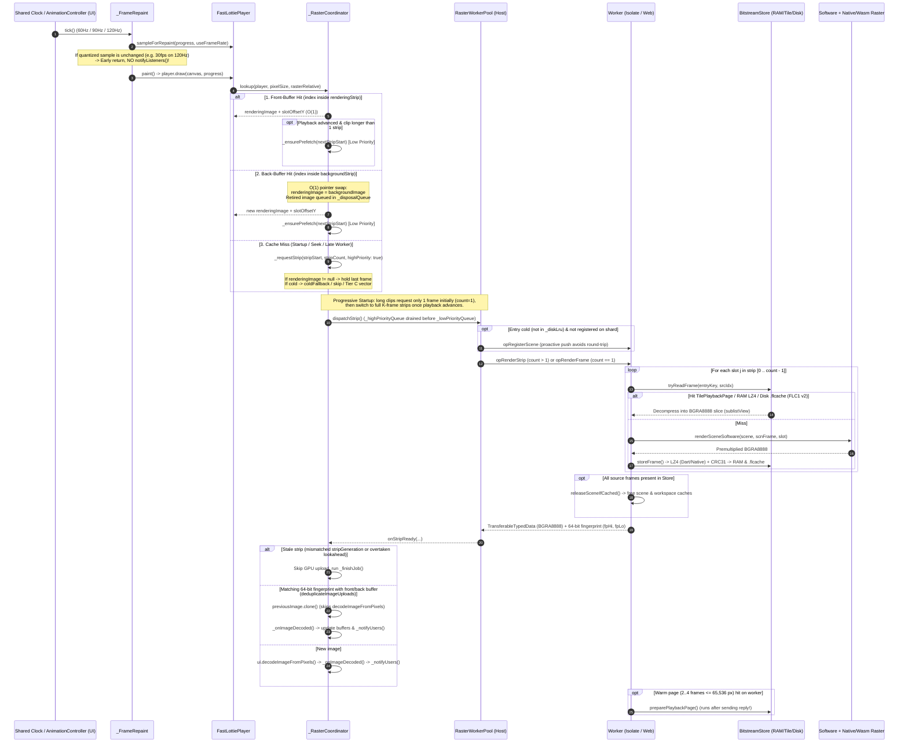

# Architecture and Design Choices (`fastlottie`)

> **30-second summary:**  
> `fastlottie` achieves smooth, low-overhead playback by splitting work into **two independent phases**:
> 1. **Compile-Once Static Compilation:** Decodes `.json`/`.tgs` on a background isolate into a pure-Dart object graph (zero `dart:ui` dependencies), packs keyframes into columnar `TypedData`, and computes a deterministic 128-bit `contentKey`.
> 2. **Off-UI Raster & Caching Pipeline:** Instead of rebuilding `ui.Path` objects and drawing complex vectors on the Flutter UI thread every frame, widgets default to offloading rasterization to a **Worker Pool** (assisted by **Native C / WebAssembly kernels**), compressing frames with **LZ4 / 16×16 tiles**, persisting them to disk (`.flcache`), and uploading vertical multi-frame **Mini-Strips** to the GPU so the UI thread only executes a single `canvas.drawImageRect`.

Related documentation: [Native raster & warm playback](native-playback.md) · [Data layout & SIMD](data-layout.md) · [Playback optimization experiments](playback-experiments.md) · [Supported Lottie operations](supported-ops.md).

---

## 1. High-Level Architecture

```mermaid
flowchart TB
    subgraph Ingest["1. Ingest & Decode"]
        SRC[".json / .tgs (GZip) / Asset / Network URI"]
        NET["network_io.dart\nHttpClient + FastLottieCancelToken\nRaw disk cache (.tgsbin, atomic .tmp.$pid.$seq)"]
        DEC["decoding.dart: decodeLottieBytes()\nGZip sniff (0x1f 0x8b), 16 MiB zip-bomb cap"]
        SRC --> NET --> DEC
    end

    subgraph Compile["2. Off-UI Compile & Normalize (RasterScene)"]
        COMP["compiler.dart + expressions.dart\nFail-fast whitelist validation\nStatic Expression, Trim DAG, Layer Control"]
        TRACK["track.dart: Keyframes & Track\nColumnar TypedData + O(1) cursor + Float32x4 SIMD\nBracketed Newton-Raphson + sRGB & SpatialCurve LUT (129 samples)"]
        HASH["content_key.dart: 128-bit contentKey\nDeterministic across Isolate/Web (+ _fused1 suffix for fused fill)"]
        FORK["fork.dart + scene_snapshot.dart\nShare immutable Keyframes via Isolate.exit (zero-copy)\nOptional binary snapshot FLM1 v2 + LZ4"]
        DEC -->|"UTF-8 byte reader"| COMP --> TRACK --> HASH --> FORK
    end

    subgraph UI["3. Flutter Widget & UI Orchestration"]
        WIDGET["widget.dart + source_widget.dart\nFastLottie / Asset / Bytes / Network / View\nFastLottiePlaybackScope (active / prewarm / hidden)\n_FrameRepaint skips duplicate quantized samples"]
        PLAYER["player.dart: FastLottiePlayer.draw()\nMemoized BoxFit layout + DPR + Frame Quantization"]
        FORK --> WIDGET --> PLAYER
    end

    subgraph Tiers["4. Three Rendering Tiers"]
        TIER1["Tier A: Prewarmed GPU Frames (prepareRaster)\nPre-renders all source frames to List<ui.Image> (32 MiB default cap)"]
        TIER2["Tier B (Default): Shared Mini-Strip Ping-Pong\n(raster_cache.dart + raster_coordinator.dart)\nDouble-buffered K-frame strips, 32 MiB VRAM budget, batched disposal"]
        TIER3["Tier C (Fallback / Subframe): Direct Canvas + LRU ui.Picture\nDirect vector draw or up to 120 ui.Pictures / 100k commands"]
        PLAYER -->|"1. prepareRaster called"| TIER1
        PLAYER -->|"2. Default (usePipeline: true)"| TIER2
        PLAYER -->|"3. usePipeline: false / useFrameRate: false / cold miss"| TIER3
    end

    subgraph Workers["5. Sharded Worker Pool & Native/Wasm Kernels"]
        POOL["worker_pool.dart: RasterWorkerPool\nNative: 2..4 Isolates (FNV-1a) | Web: 1..2 Web Workers\nProactive scene push when cold, max 24 scenes/shard"]
        STORE["bitstream_cache.dart + tile_playback.dart + lz4.dart\nL1 RAM: LZ4 _ramLru + TilePlaybackPage (16x16 tiles)\nL2 Disk: .flcache (FLC1 v2, self-healing CRC31)"]
        RAST["software_scene.dart + native/*.c / fastlottie_simd.wasm\nAdaptive Bézier flattening (Fused Fill) -> PolyPath (SoA)\n24.8 fixed-point scanline (up to 262,144 native cells)\nSWAR / NEON / SSE2 Premultiplied BGRA8888"]
        TIER2 <-->|"Mini-Strip BGRA8888\nTransferableTypedData + 64-bit dedup"| POOL
        POOL --> STORE
        STORE -->|"Cache Miss"| RAST
        RAST -->|"LZ4 (Dart / Native C) + CRC31"| STORE
    end
```

---

## 2. Three Rendering Tiers & Selection Rules

When [`FastLottiePlayer.draw`](../lib/src/flutter/player.dart) is called, FastLottie selects one of three rendering paths in priority order:

| Tier | When Selected | How It Works | Trade-offs |
| :--- | :--- | :--- | :--- |
| **Tier A: Prewarmed GPU Frames** | `await player.prepareRaster(...)` has completed and `useFrameRate: true` | Pre-renders all source frames into `List<ui.Image>` on the GPU (1 frame if `isStatic`); each draw calls `canvas.drawImageRect`. | Lowest possible per-frame UI cost, at the expense of startup preparation time and VRAM (`32 MiB` default per player). |
| **Tier B: Shared Mini-Strip Ping-Pong (Default)** | `usePipeline: true` (via shared `DefaultRasterCacheScope`) or a custom `rasterCache` + `useFrameRate: true` | Background workers software-rasterize $K$-frame vertical strips (**Mini-Strips**), store them in LZ4/tile caches, and maintain double-buffered `ui.Image` handles shared across identical widgets. | Best balance for lists, sticker grids, and chat feeds: very light UI thread, no scroll jank, hard VRAM cap (`32 MiB` default across the whole cache). |
| **Tier C: Direct Vector Canvas & `ui.Picture` LRU** | `usePipeline: false`, `useFrameRate: false` (subframe interpolation), or cold miss with `allowUiVectorFallback: true` | Draws vectors directly onto `ui.Canvas`; when `rasterCache` is null and `useFrameRate: true`, caches up to `120` `ui.Picture` frames / `100,000` commands (or shares a `FastLottiePictureCache`). | Resolution-independent vector sharpness and subframe support, but heavier UI/GPU load when many complex animations run simultaneously. |

### Cache Miss Policy on Tier B (Preventing Scroll Jank)

In [`_RasterCoordinator.lookup`](../lib/src/flutter/raster_coordinator.dart), when the target sample is not yet ready:
1. **Front Buffer Already Exists (`renderingImage != null`):** The coordinator **holds the last valid frame slot** (`lastRenderingSlot`) and dispatches the new strip in the background — it does **not** fall back to UI-thread vector rendering, preventing scroll stutters.
2. **Complete Cold Miss (`renderingImage == null`):**
   - If the caller provided `coldFallback` → paints `coldFallback(canvas, target)`.
   - If `!requestRaster` or `allowUiVectorFallback == false` → skips painting while waiting for the worker response.
   - Otherwise (`allowUiVectorFallback == true`, the default) → temporarily draws via **Tier C** so the first frame appears immediately.

---

## 3. Mini-Strip Ping-Pong Pipeline Lifecycle

Instead of rendering and transferring individual frames back and forth between workers and the UI isolate, `fastlottie` packs $K$ consecutive frames vertically into a single image buffer (Mini-Strip) orchestrated with a **2-lane priority queue and backpressure control**:

---

## 4. Layer-by-Layer Deep Dive

### 4.1. Ingest, Decoding & Static Compilation

- **Safe Decoding (`lib/decoding.dart`):** `decodeLottieBytes()` checks the first two bytes (`0x1f 0x8b`) to auto-decompress `.tgs` (GZip) payloads while enforcing a `maximumBytes = 16 MiB` ceiling against zip bombs (using streaming `dart:io` zlib on native platforms and `package:archive` on web).
- **Direct UTF-8 Byte Parsing (`lib/src/scene/lottie_json_reader.dart`):** Parses Lottie JSON directly from UTF-8 bytes without allocating an intermediate `Map<String, dynamic>` DOM tree, minimizing GC pressure and parse latency.
- **Cancellable Network Fetching (`lib/src/network/network_io.dart`):** `FastLottieComposition.loadNetwork` (and `FastLottieNetwork`) supports `FastLottieCancelToken` to immediately call `request.abort()` / `socket.destroy()` when widgets dispose or scroll off-screen. Raw payloads can be cached to disk as `<128-bit-uri-hash>.tgsbin` using temp files + atomic rename (`.tmp.$pid.$seq`).
- **Fail-Fast Compiler (`lib/src/scene/compiler.dart`):**
  - Rather than silently dropping unsupported properties and rendering broken visuals, `_Compiler.check` validates every JSON key against `const Set<String>` whitelists (and rejects unsupported `ddd`, `ao`, `bm`, and `hasMask` combinations). Anything outside the subset throws `UnsupportedLottieException` with its exact JSON path (`$.layers[i]...`).
  - **Deterministic compilation order:** validate metadata → `_compileMasks()` → resolve expressions → build transforms & layer content → once all layers exist, run `_linkMattes()` (track mattes & Set Matte) and `_linkParents()` with cycle detection. This preserves deterministic error paths and `commands` counts used for cache budgets.
- **Static Expression Compilation (`lib/src/scene/expressions.dart`):**
  - `_ExpressionResolver.resolveLayer` resolves supported After Effects property expressions (such as `$bm_rt = content('...').transform.scale`, `rotation`, `opacity`, `xPosition`/`yPosition`) at compile time, detects cycles via a `resolving` set, and **rewires** the source track directly into the target. **Zero JavaScript runs per frame.**
  - `_ShapePathCompiler` resolves path-reference expressions by sharing compiled geometry identity while preserving the target's own transform, paint, and modifiers.
- **Trim Paths DAG (`lib/src/scene/path_ops.dart`):** Because a `tm` (`_Trim`) modifier can affect shapes already collected by earlier styles, the compiler wraps geometries in `_Shape` nodes, freezes original inputs into `trim.inputs`, and replaces each `_Shape`'s payload with `_TrimPart(trim, index)`. The compiled result is a **pure-Dart DAG** with no `dart:ui` objects and no per-frame layer-tree traversal.
- **Template-Fork Pattern (`_Fork`), `contentKey` & Snapshots (`_SceneSnapshot`):**
  - `FastLottieComposition._template` is an immutable pure-Dart `_Compiler` graph with zero `dart:ui` state, so `fromBytesAsync` / `loadAsset` / `loadNetwork` compile completely on a persistent background compile isolate pool and transfer the result back via `Isolate.exit` without re-serializing to JSON.
  - `contentKey` is a deterministic 128-bit hash (`content_key.dart`, with a `_fused1` suffix in `RasterScene.contentKey` when `defaultFuseFillTransforms` is enabled). When `prepareForPlayback()` is called, `_preparedScene = _template.fork(warm: true)` pre-computes static flags (`isStatic`, `isPathStatic`, `isSpatialStatic`, `isTranslationOnly`, `isSpatialIdentity`).
  - The first vector player adopts `_preparedScene`; subsequent players fork lightweight clones sharing immutable `Keyframes` and **sharing constant `Track` instances** (since `Track.constant` never mutates `_cursor`). Once a player renders from the shared raster cache, `_sceneState` and `_preparedScene` are discarded (`discardPreparedScene()`).
  - `_SceneSnapshot` (`lib/src/scene/scene_snapshot.dart` + `lib/src/cache/snapshot_envelope.dart`) supports serializing compiled scene graphs into an internal binary format (`magic = 0x314d4c46` `'FLM1'`, `version = 2`, LZ4-wrapped) with lazy restoration (`deferSnapshot` / `restoreSnapshot`) for experimental packs and benchmarks.

### 4.2. Columnar Data Layout & SIMD Interpolation (`lib/src/scene/track.dart`)

See detailed kernel benchmarks in [data-layout.md](data-layout.md).

- **Columnar `TypedData` (`Keyframes`):** Instead of heap-allocated `Keyframe` object lists, each track stores four flat contiguous typed arrays:
  1. `Float64List times`: keeps timestamps tightly packed so binary search only touches the `times` column in L1 cache without pulling coordinates or colors.
  2. **$O(1)$ Temporal Cursor (`_cursor`):** During sequential playback, `Track.at(frame)` checks `[_cursor, _cursor + 1]` first, hitting in $O(1)$ without binary search.
  3. `Int32List metadata`: three contiguous sections — `[flags | easeCount]`, `[endOffset]` (pointing directly to the next key when no explicit `e` exists, avoiding duplication), and `[easeOffset]`.
  4. `Float32List values` + **`Float32x4` SIMD:** Key values are contiguous; when `FastLottieOptions(useSimd: true)` (enabled by default) and `width >= 32` floats share easing, stride is padded to a multiple of 4 to interpolate 4 floats per step via `Float32x4List` + scalar tail.
- **Pure-Dart Math (Zero `dart:ui` Dependency):**
  - *Temporal easing:* Solves $x(t) = \text{fraction}$ using **Bracketed Newton-Raphson** (up to 16 steps, falling back to `[lo, hi]` bisection when the derivative flattens).
  - *Spatial tangents (`_SpatialCurve`):* Precomputes a 129-sample pure-Dart arc-length table instead of calling `ui.Path.computeMetrics()`.
  - *Gamma-correct color blending:* Static `_srgbToLinear` (256 entries) and `_linearToSrgb` (4,097 entries with fractional linear interpolation) lookup tables replace per-frame `math.pow()`.

### 4.3. Software Rasterizer & Native C / Wasm Acceleration

Because `dart:ui` (`Canvas`, `Path`, `Picture`) cannot execute inside background Dart isolates or browser Web Workers, `fastlottie` implements a complete 2D vector rasterization pipeline in [`lib/src/raster/`](../lib/src/raster/raster_core.dart) and accelerates hot loops in C/SIMD (via Dart Native Assets + FFI leaf calls on native, and Wasm on web). The pure-Dart implementation serves as both the reference oracle and automatic fallback whenever native caps are exceeded.

1. **Adaptive Bézier Flattening & Fused Fill (`path_flattening.dart`, `native/fastlottie_geometry.c`):**
   - Computes flatness from the current transform's max scale: `localFlatness = (0.25 / maxScale).clamp(0.005, 1.5)` (or `0.25 px` in device space for fused fills), subdividing recursively with De Casteljau (up to depth 10) into a Struct-of-Arrays `PolyPath` (`Float64List vx, vy`, `Int32List contourStart, contourEnd`, `Uint8List contourClosed`).
   - **Fused Fill (`defaultFuseFillTransforms = true`):** Enabled by default on native and web (disable on native with `--dart-define=FASTLOTTIE_FUSED_FILL=false`). For plain animated Bézier fills (without stroke, dash, trim, boolean ops, or grouped sources), control points are transformed directly into device space prior to subdivision, eliminating intermediate `_workPolyB` copies.
   - **Native Bézier flattening (`fl_flatten_bezier`):** Opt-in via `--dart-define=FASTLOTTIE_NATIVE_BEZIER=true` on native (up to 128 source vertices / 8,192 output vertices), falling back to Dart if limits are exceeded.
2. **Stroke Expansion & Dashing (`path_flattening.dart`, `native/fastlottie_geometry.c`):**
   - `_expandStroke` eliminates `atan2`/`acos`/`cos`/`sin` by **recursively bisecting unit normals** based on chord error (sagitta) for round joins/caps, handling inner creases cleanly so the `NonZero` winding rule leaves no gaps.
   - On native platforms, calls leaf FFI `fl_expand_stroke` (up to 1,024 source points, 128 contours, 8,192 output vertices).
3. **Early Bounding-Box Clip Culling & Workspace Caches (`software_scene.dart`, `raster_workspace.dart`):**
   - `_renderStyleInto` maps `style.drawBounds(frame)` into device coordinates (+2 px AA margin) and intersects with the active clip rect; empty intersections exit in $O(1)$ before Bézier flattening or scanline conversion.
   - `RasterWorkspace` maintains per-worker caches for static paths (`maxStaticPaths = 512`), trim metrics (`maxStaticMetrics = 256`), gradient LUTs (`maxStaticLuts = 256`), and **static coverage** (`_coverage`, capped at `1 MiB` / `256` entries, keyed by resolved transform + clip rect). When a worker releases a fully cached scene (`ws.releaseScene(scene)`), only that scene's entries are dropped.
4. **24.8 Fixed-Point Analytic Scanline (`scanline_rasterizer.dart`, `native/fastlottie_coverage.c`):**
   - Converts geometry into **24.8 fixed-point** coordinates (256 subpixel levels per pixel), supporting `NonZero` and `EvenOdd` fill rules and emitting RLE-compressed horizontal spans (`RleSpans`: two 32-bit words per span: `word0 = (y << 16) | x`, `word1 = (len << 8) | (cov - 1)`).
   - On Native/Wasm: `NativeCoverageWorkspace` (`fl_dense_raster` / `fl_dense_raster_borrowed` / `fl_dense_raster_solid_borrowed`) uses fixed-point cells with a **per-row 64-bit bitset** (`uint64_t *used`) capped at **262,144 cells per draw** (`borrowGeometry` fast path for compact draws `<= 512` vertices, `<= 64` contours, `<= 128×128` px); oversized draws fall back seamlessly to pure-Dart `FtScanlineRasterizer`.
5. **Premultiplied BGRA8888 Blending (`swar_blender.dart`, `native/fastlottie_simd.c`):**
   - **Dart:** **64-bit SWAR** blends `R+B` (`0x00FF00FF`) and `A+G` (`0xFF00FF00`) channel pairs simultaneously; uses second-order forward differences + `Float32x4.sqrt()` for radial gradients; uses a 16.16 `_invAlphaLut` + integer BT.601 weights (`19595`, `38470`, `7471`) for division-free luma mattes.
   - **Native/Wasm:** `fastlottie_simd.c` vectorizes `fastlottie_fill_solid_spans`, `fastlottie_blend_rect`, `fastlottie_blend_solid`, `fastlottie_gradient_spans`, `fastlottie_inner_shadow`, and `fastlottie_composite_matte` with **ARM NEON / SSE2** (plus the fused `fl_dense_raster_solid_borrowed` path that rasterizes and fills solid spans in a single native call).

### 4.4. Mini-Strips, VRAM Budgeting & Queue Backpressure

Implemented in [`raster_cache.dart`](../lib/src/flutter/raster_cache.dart) and [`raster_coordinator.dart`](../lib/src/flutter/raster_coordinator.dart).

- **Vertical Strip Packing ($K$ frames in 1 `ui.Image`):**
  - Workers allocate a single buffer of height $H_{\text{strip}} = m \cdot H + (m - 1) \cdot \text{padY}$ and clear only the $(m - 1)$ **1-pixel transparent gutter rows (`padY = 1`)** between slots (preventing edge bleed under bilinear `FilterQuality.low` filtering without wasting bandwidth clearing pixels that every slot overwrites).
  - All $m$ frames travel in **1 IPC message**, **1 `TransferableTypedData`**, and **1 GPU upload (`ui.decodeImageFromPixels`)**. On paint, [`FastLottiePlayer.draw`](../lib/src/flutter/player.dart) crops the active slot at `slotOffsetY` via `canvas.drawImageRect`.
  - Default adaptive $K$ thresholds by single-frame byte size ($W \times H \times 4$), always clamping strip height to $\le 4096\text{ px}$:
    - $\le 64\text{ KiB}$: $K = 4$ (or packs the entire clip if `totalFrames <= 6`, requiring only **1 VRAM buffer** and **0 IPC / 0 GPU uploads** on subsequent loops).
    - $\le 256\text{ KiB}$: $K = 4$.
    - $\le 1\text{ MiB}$: $K = 2$.
    - $> 1\text{ MiB}$ or static/poster: $K = 1$.
- **Progressive First Frame (`progressiveFirstFrame: true` by default):** For clips longer than $K$, the initial request renders only the current sample (`count = 1`) without prefetching to minimize time-to-first-frame; once playback advances (`hasPlayedAdvance = true`), the entry transitions to full $K$-frame strips with lookahead prefetching.
- **$O(1)$ VRAM Budget & Adaptive Strip Demotion (`_demoteEntry`):**
  - Default GPU payload cap `maximumBytes = 32 MiB`, separating `_unpinnedAnims` and `_unpinnedPosters` LRU queues (with configurable `reservedPosterBytes`, default `0`).
  - When pinned entries reach $\ge 4$ and consume $\ge 50\%$ of budget, `_acquire` computes a `fairShare = nonPosterCeiling ~/ (pinnedCount + 1)` entry budget. If evicting unpinned LRU entries is still insufficient, `_demoteEntry` steps down active $K > 1$ entries ($K \to \lfloor K/2 \rfloor \to 1$) and increments `stripGeneration` so oversized in-flight uploads are discarded without losing LZ4/disk caches.
  - **Batched `ui.Image` Disposal:** Retired textures go into `_disposalQueue` and are disposed in batches (`disposalBatchSize = 8`) inside `addPostFrameCallback` to prevent GPU driver stalls during fast scrolling.
- **Backpressure & Duplicate Texture Reuse:**
  - **2-Lane Priority Queue:** Separates `_highPriorityQueue` (currently visible frames) from `_lowPriorityQueue` (lookahead prefetches), supporting in-place promotion/demotion and evicting low-priority prefetches first when hitting `maximumPendingFrames = 64`.
  - **Latest-Desire-Wins & Per-Shard Limits:** Each entry has at most `1` `inFlight` job and `1` `pending` slot (newer requests overwrite `pending`). On native platforms, each shard admits `1` job for cold entries without a front buffer (so scrolled-away requests stay cancellable on the host) and `2` jobs once a front buffer exists to feed lookahead.
  - **Zero-Host-RAM Duplicate Upload Skipping (`deduplicateImageUploads: true` by default):** Workers combine CRC31 with an independent 32-bit multiplicative hash on each compressed frame payload into a JS-safe 64-bit `(fpHi, fpLo)` fingerprint, folding $K$ slots in $O(K)$ without rescanning uncompressed BGRA pixels. The UI isolate retains only `(fpHi, fpLo)` and a non-owning reference to front/back `ui.Image` (**0 bytes of pixel RAM on host**); on a dimension + fingerprint match (~$2^{-64}$ collision probability), the host clones `image.clone()` and skips `ui.decodeImageFromPixels`. Setting `deduplicateImageUploads: false` disables worker fingerprinting as well.

### 4.5. Worker Pool, 3-Tier Storage (Tiles + LZ4 RAM + `.flcache`) & Self-Healing

- **Sharding & Scene Management (`lib/src/worker/worker_pool.dart`, `raster_worker.dart`):**
  - Native pools spawn `2..4` persistent isolates (based on `Platform.numberOfProcessors`, overridable `1..8`) routed by `FNV-1a(entryKey) % workerCount`. Web pools spawn `1..2` Web Workers (`hardwareConcurrency >= 4 ? 2 : 1`).
  - Because every request for a given `entryKey` always routes to the exact same shard, **each `.flcache` file has a single exclusive reader/writer worker**, completely eliminating file locking.
  - **Proactive Scene Registration:** If `entryKey` is absent from `_diskLru` (or disk cache is disabled) and not yet registered on the target shard, the host bundles `opRegisterScene` with the first request to eliminate a `repSceneMissing` round-trip. Each shard retains up to `maxWorkerScenes = 24` scenes and calls `releaseSceneIfCached()` to drop the scene and workspace caches as soon as `BitstreamStore.hasAllFrames()` becomes `true`.
- **Canonical Cache Key (`formatBitstreamEntryKey`):** Keys use `${contentKey}_${width}x${height}_f$sourceFrameCount` (source frame count, `1` if static), so `poster`, `24 FPS`, `30 FPS`, `60 FPS`, `framesPerStrip: 1`, and `framesPerStrip: null` at the same physical size share 100% of compressed RAM and `.flcache` disk storage.
- **L1 RAM — Compressed LRU + `TilePlaybackPage` (`bitstream_cache.dart`, `tile_playback.dart`):**
  - Total compressed RAM budget defaults to `maximumCompressedMemoryBytes = 32 MiB`, divided evenly across worker shards.
  - `_ramLru` retains LZ4-compressed frames (or raw bytes when incompressible).
  - For warm pages (`2..4` resident frames in `_ramLru`, up to $256 \times 256$ = `65,536` pixels/frame), after replying to the UI isolate, the worker attempts to build a `TilePlaybackPage`: partitioning frames into **16×16 pixel tiles** and deduplicating identical tiles (accepted only when changed tiles $\le 1/3$ and size fits within $\min(\text{ramLimit}/8, 2 \times \text{originalBytes})$). Both `_ramLru` and `_tilePages` share a unified `_ramClock` LRU, and `TilePlaybackCursor` allows single-frame workers to skip unchanged tiles in persistent output buffers.
- **L2 Disk — `.flcache` (`FLC1` v2) & Self-Healing (`bitstream_cache.dart`, `lz4.dart`, `native/fastlottie_cache.c`):**
  - **File Layout (`<entryKey>.flcache`):**
    - *32-byte Header (Little-Endian):* `magic = 0x464C4331 ('FLC1')`, **`version = 2`**, `width`, `height`, `frameCount`, `flags` (`bit 0 = Completed`, `bit 1 = Poster`), `writtenCount`, `uncompressedFrameBytes`.
    - *Index Table (`frameCount * 16` bytes):* each slot stores `uint64 offset`, `uint32 storedLen`, `uint32 (isRaw << 31) | crc31`.
    - *Append-Only Payload:* frames are appended as rendered (supporting out-of-order writes).
  - **LZ4 & ARM CRC32:** For frames $\le 256\text{ KiB}$ on native platforms, `cache_codec_io.dart` invokes leaf FFI (`fastlottie_encode_cache_frame` / `fastlottie_decode_cache_frame`, using hardware ARMv8 CRC32 `__crc32d`/`__crc32b` when `AT_HWCAP` detects support on Android). Larger frames and other platforms use allocation-free pure-Dart `Lz4Codec` (`Lz4Scratch`, with an `offset == 4` fast path for flat/transparent regions).
  - **Self-Healing & Resource Caps:** On a CRC31 mismatch or out-of-bounds offset (e.g., after an abrupt app kill), `BitstreamStore` zeroes the corrupt index slot, truncates trailing garbage, and re-renders only that frame. Concurrent open file handles are capped at `maximumOpenFiles = 16`, and the host maintains a global disk LRU within `maximumDiskBytes = 128 MiB` (prioritizing currently visible `activeKeys`).

### 4.6. Widget Layer & Cross-Platform Separation (Native IO vs. Web)

- **Widgets (`widget.dart`, `source_widget.dart`):**
  - `FastLottie` manages a `FastLottiePlayer`, coalesces repeating autoplay widgets onto a single shared vsync `Ticker` (`_SharedPlaybackClock`) or accepts an external `controller`, acquires the default shared raster cache via `DefaultRasterCacheScope`, and triggers `prewarm()` in `didChangeDependencies` whenever `width` and `height` are known.
  - `FastLottieAsset`, `FastLottieBytes`, and `FastLottieNetwork` extend `_FastLottieSource`, handling async loading (`placeholderBuilder`, `errorBuilder` with `retry`) and automatic cancellation via `FastLottieCancelToken`.
  - `FastLottieView` paints a caller-owned `FastLottiePlayer` (e.g., after `prepareRaster`).
  - `FastLottiePlaybackScope` lets list/viewport owners pass visibility policy down without per-tick `RenderBox` scans:
    - `active`: plays normally.
    - `prewarm`: displays frame-0 poster (`FastLottieRasterMode.poster`), stops internal ticker.
    - `hidden`: preserves layout dimensions (`SizedBox`), detaches repaint listeners, stops internal ticker, and releases its player/cache lease.
  - **`_FrameRepaint`:** Filters animation ticks through `sampleForRepaint(progress, useFrameRate)` — never calls `setState()`, and suppresses `notifyListeners()` whenever the quantized frame is unchanged (e.g., a 30 FPS clip on a 120 Hz screen). Automatically pauses internal ticks for static compositions or when `MediaQuery.disableAnimationsOf(context)` is true.
- **Conditional Imports for Native vs. Web:**
  - `raster_flutter_canvas.dart` / `raster_no_canvas.dart`: isolates `dart:ui` from `raster_core.dart` so the exact same raster core runs inside a JS/Wasm Web Worker.
  - `raster_browser.dart` / `raster_web_protocol.dart`: communicates with `lib/src/wasm/fastlottie_worker.js` and `fastlottie_simd.wasm` via positional arrays + `Transferable ArrayBuffer`; automatically falls back to inline execution if workers are blocked or disabled (`FASTLOTTIE_DISABLE_WEB_WORKER`).
  - `isolate_io.dart` / `isolate_stub.dart`, `platform_io.dart` / `platform_stub.dart`, `network_io.dart` / `network_stub.dart`, `simd_io.dart` / `simd_wasm.dart` / `simd_web.dart` / `simd_stub.dart`.

---

## 5. Source Module Map

| Source File | Core Responsibility |
| :--- | :--- |
| `lib/fastlottie.dart` | Public entry point: exports widgets, composition, player, caches, SIMD helpers, and options. |
| `lib/decoding.dart` | `decodeLottieBytes()`: auto-decompresses `.tgs` (GZip `0x1f 0x8b`) with a `16 MiB` zip-bomb cap. |
| `lib/src/flutter/composition.dart` | `FastLottieComposition`: asset/bytes/network loading, background compile pool, `_template` & `_preparedScene`. |
| `lib/src/flutter/player.dart` | `FastLottiePlayer`: 3-tier render dispatch, memoized layout bounds, `prepareRaster`, `prewarm`. |
| `lib/src/flutter/raster_cache.dart` | `FastLottieRasterCache`, `DefaultRasterCacheScope`: $O(1)$ VRAM budget, adaptive $K$, `_demoteEntry`, `_disposalQueue`. |
| `lib/src/flutter/raster_coordinator.dart` | `_RasterCoordinator`: front/back strip swaps, lookahead prefetch, 2-lane priority queue, front-buffer hold, 64-bit upload dedup. |
| `lib/src/flutter/picture_cache.dart` | `FastLottiePictureCache`: shared bounded LRU of vector `ui.Picture` frames for `usePipeline: false`. |
| `lib/src/flutter/widget.dart` | `FastLottie`, `FastLottieView`, `FastLottiePlaybackScope`, `_SharedPlaybackClock`, `_FrameRepaint`. |
| `lib/src/flutter/source_widget.dart` | `FastLottieAsset`, `FastLottieBytes`, `FastLottieNetwork`: async source widgets with placeholder/error/retry and cancel token. |
| `lib/src/flutter/software_session.dart` | `FastLottieSoftwareSession`, `debugRenderSoftwareFrame`: reusable software raster session for tests and benchmarks. |
| `lib/src/scene/options.dart` | `FastLottieOptions` (`useSimd`), `UnsupportedLottieException`. |
| `lib/src/scene/lottie_json_reader.dart` | Direct zero-DOM UTF-8 byte reader for Lottie JSON. |
| `lib/src/scene/compiler.dart` | `_Compiler`: fail-fast whitelist validation, track/mask/layer-control compilation, matte & parent linking. |
| `lib/src/scene/expressions.dart` | `_ExpressionResolver`, `_ShapePathCompiler`: compile-time property and shape-path expression wiring. |
| `lib/src/scene/track.dart` | `Keyframes`, `Track`, `_SpatialCurve`: columnar `TypedData`, $O(1)$ cursor, Newton-Raphson, `Float32x4`, sRGB LUTs. |
| `lib/src/scene/scene.dart` | `_Transform`, `_Layer`, `_Group`, `_BezierGeometry`, `_Primitive`, `_PolyStarGeometry`, `_Style`, `_Mask`. |
| `lib/src/scene/path_ops.dart` | `_Shape`, `_TrimPart`, `_Trim`, `_Dash`, `_MergePathSource`: modifier DAG and `ui.PathMetric` caching. |
| `lib/src/scene/gradient.dart` | `_GradientSpec`: in-place color/alpha stop merging and `ui.Shader` creation for Canvas rendering. |
| `lib/src/scene/fork.dart` | `_Fork`: clones per-player mutable state, shares immutable `Keyframes` & constant tracks, warms static flags. |
| `lib/src/scene/content_key.dart` | `_ContentKeyHasher`: deterministic 128-bit scene content hash. |
| `lib/src/scene/scene_snapshot.dart` | `_SceneSnapshot`: internal binary (`FLM1` v2) serialization/deserialization for immutable scene graphs (`deferSnapshot`). |
| `lib/src/raster/raster_core.dart` | Core library shared between Flutter and browser workers; defines `RasterScene` (`_fused1`) and `renderSceneSoftware`. |
| `lib/src/raster/software_scene.dart` | `_renderSceneSoftware`, `_renderStyleInto`: software scene walk, early bounds culling, masks/mattes, inner shadow, gradients. |
| `lib/src/raster/raster_workspace.dart` | `RasterWorkspace`: scratch buffers, per-scene coverage/path/trim/gradient caches, and memory reclamation. |
| `lib/src/raster/raster_geometry.dart` | `PolyPath`, `Float64Scratch`: allocation-free Struct-of-Arrays polyline representation. |
| `lib/src/raster/path_flattening.dart` | Adaptive Bézier flattening (including fused fill), trim, dash, and normal-bisection stroke expansion (`_expandStroke`). |
| `lib/src/raster/scanline_rasterizer.dart` | `FtScanlineRasterizer`, `RleSpans`: 24.8 fixed-point analytic scanline rasterizer & RLE spans (Dart fallback). |
| `lib/src/raster/swar_blender.dart` | `SwarBlender`: 64-bit SWAR premultiplied BGRA8888 blending, 2nd-order + `Float32x4` radial gradients, `_invAlphaLut`. |
| `lib/src/worker/worker_pool.dart` | `RasterWorkerPool`: FNV-1a sharding, proactive scene registration, global `_diskLru` management. |
| `lib/src/worker/raster_worker.dart` | `softwareWorkerEntry`: worker loop, `maxWorkerScenes = 24`, cache lookup/store, `renderSceneSoftware`. |
| `lib/src/worker/worker_messages.dart` | Internal opcodes and Dart records exchanged between pool and workers. |
| `lib/src/worker/raster_browser.dart` / `stub.dart` | Web Worker lifecycle, Wasm asset loading, and inline fallback when workers fail or are disabled. |
| `lib/src/worker/raster_web_protocol.dart` | Wire-format codec encoding Dart records into positional arrays with `Transferable ArrayBuffer`. |
| `lib/src/cache/bitstream_cache.dart` | `BitstreamStore`: compressed RAM LRU, `TilePlaybackPage`, `.flcache` (`FLC1` v2) disk store, self-healing CRC31. |
| `lib/src/cache/tile_playback.dart` | `TilePlaybackPage`, `TilePlaybackCursor`: 16×16 tile deduplication across 2–4 warm frames in RAM. |
| `lib/src/cache/lz4.dart` | `Lz4Codec`, `Lz4Scratch`: allocation-free pure-Dart LZ4 codec (`offset == 4` fast path). |
| `lib/src/cache/cache_codec_io.dart` / `stub.dart` | Leaf FFI bindings to native C LZ4 encoder/decoder and ARM64 CRC32 (`<= 256 KiB`). |
| `lib/src/cache/snapshot_envelope.dart` | `packCompiledSnapshot` / `unpackCompiledSnapshot`: LZ4 envelope for `_SceneSnapshot`. |
| `lib/src/platform/simd_io.dart` / `wasm.dart` / `web.dart` / `stub.dart` | Bindings for `NativeCoverageWorkspace`, `NativePixelBuffer`, `NativeSpansBuffer`, and C/Wasm blend/gradient/matte kernels. |
| `lib/src/platform/geometry_kernel_io.dart` / `stub.dart` | Leaf FFI bindings for `flattenBezierNative` and `expandStrokeNative`. |
| `lib/src/platform/c_library.dart`, `wasm_builder.dart` & `hook/*.dart` | Dart Native Assets hooks (`build.dart`, `link.dart`) compiling C kernels with `-O3` and Wasm data assets. |
| `lib/src/platform/isolate_io.dart` / `stub.dart` | Worker isolate communication via `SendPort`/`ReceivePort` + `TransferableTypedData`. |
| `lib/src/platform/platform_io.dart` / `stub.dart` | `PlatformFileHandle` (synchronous `RandomAccessFile`) and `PlatformDiskFs`. |
| `lib/src/platform/raster_flutter_canvas.dart` / `no_canvas.dart` | Conditional import bridge decoupling `dart:ui` from `raster_core.dart`. |
| `lib/src/network/network_io.dart` / `stub.dart` / `network_types.dart` | HTTP/HTTPS fetching with `FastLottieCancelToken` and raw `.tgsbin` disk cache. |
| `native/fastlottie_coverage.c`, `fastlottie_simd.c`, `fastlottie_geometry.c`, `fastlottie_cache.c` | Optimized C kernels: bitset scanline, NEON/SSE2 blending, Bézier flattening, stroke expansion, LZ4 & ARM64 CRC32. |
| `lib/src/wasm/fastlottie_worker.js`, `fastlottie_simd.wasm` | Prebuilt Web Worker JS bundle and standalone C Wasm kernels for Flutter Web. |

---

## 6. Performance Optimization Roadmap & Status

Latest experiments and notes are documented in [Playback experiments](playback-experiments.md) and [Native playback](native-playback.md).

| ID | Optimization | Target | Status | Mechanism & Key Impact |
| :---: | :--- | :--- | :---: | :--- |
| **#1** | **Sub-tree Static Layer Memoization** in `RasterWorkspace` | Thermal / Algorithmic | Proposed | Avoid re-rasterizing static background layers beneath animated layers on every worker frame. |
| **#2** | **Duplicate Upload Skip (64-bit Fingerprint + `ui.Image.clone`)** | Thermal / GPU | **Enabled by default** | Workers compute a 64-bit `(fpHi, fpLo)` pair from compressed payloads and fold $K$ slots in $O(K)$; host retains 0 bytes of pixel RAM, matches `(width, height, fpHi, fpLo)` against front/back buffers, and calls `image.clone()` (~$2^{-64}$ collision probability). |
| **#3** | **Trig-Free `_expandStroke`** | Algorithmic / Thermal | **Implemented** | Replaces `atan2`/`acos`/`cos`/`sin` with recursive unit-normal bisection bounded by chord sagitta error. |
| **#4** | **Early Bounding-Box Clip Culling in `_renderStyleInto`** | Algorithmic / Thermal | **Implemented** | Intersects `style.drawBounds(frame)` with the active clip rect before Bézier/dash/stroke flattening and narrows scanline bounds. |
| **#5** | **2-Lane Priority Queue in `_RasterCoordinator`** | Resource / Latency | **Implemented** | Separates `_highPriorityQueue` (visible frames) and `_lowPriorityQueue` (prefetch) with in-place priority promotion/demotion and priority eviction. |
| **#6** | **Source-Frame Canonical Cache Keys** | Resource / Disk & RAM | **Implemented** | Keys by `${contentKey}_${w}x${h}_f$sourceFrameCount` so `poster`, `24/30/60 FPS`, and all strip sizes share `.flcache` and RAM LRU entries. |
| **#7** | **Empty Span / Sparse Tile Compaction before LZ4** | Resource / Bandwidth | Proposed | Skip large transparent regions before LZ4 compression and GPU upload. |
| **#8** | **Fused Transform + Flatten for Plain Fills** | Algorithmic / Memory | **Enabled by default** | Transforms Bézier control points into device space before De Casteljau subdivision for plain animated fills (`FASTLOTTIE_FUSED_FILL`, `_fused1` key namespace). |
| **#9** | **2nd-Order + `Float32x4` Radial Gradients & Integer Luma Mattes** | Algorithmic / SIMD | **Implemented** | Second-order forward differences with `Float32x4.sqrt()` (4 px/step) and 16.16 `_invAlphaLut` + integer BT.601 without divisions. |
| **#10** | **Perceptual Screen-Size FPS Scaling** | Thermal / Battery | Proposed | Automatically scale down sampling FPS when rendered screen area is very small. |
| **#11** | **Owner-Controlled Visibility (`FastLottiePlaybackScope`)** | Thermal / Battery | **Implemented (owner-supplied)** | Owners propagate `active` / `prewarm` / `hidden` on viewport/occlusion changes (no per-tick `RenderBox` scan); `hidden` stops internal tickers and releases cache leases. |
| **#12** | **Tile Playback & Inter-Frame RAM Deduplication** | Resource / RAM | **Implemented (16×16 tiles)** | `TilePlaybackPage` deduplicates 16×16 px tiles across 2–4 warm frames ($\le 65,536$ px/frame) instead of sequential delta-XOR replay, supporting direct random seeks within a page. |
