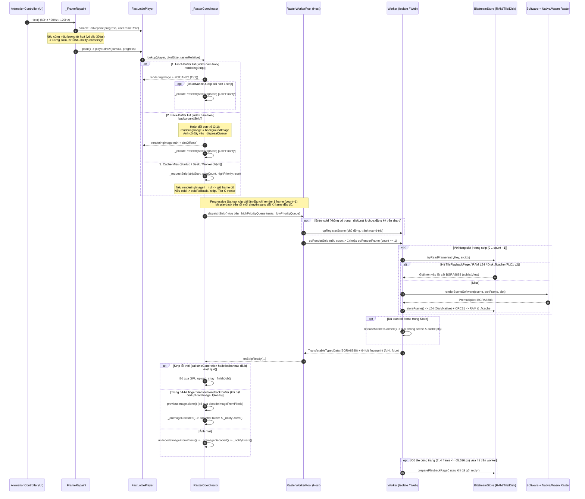

# Kiến trúc và Lựa chọn Thiết kế (`fastlottie`)

> **Tóm tắt nhanh (30 giây):**  
> `fastlottie` chạy mượt mà bằng cách tách làm **2 pha độc lập**:
> 1. **Biên dịch tĩnh 1 lần (Compile-Once):** Giải mã `.json`/`.tgs` trên background isolate thành đồ thị đối tượng thuần Dart (không dùng `dart:ui`), đóng gói keyframe dạng cột (columnar `TypedData`) và băm nội dung thành `contentKey` 128-bit.
> 2. **Kết xuất & Lưu đệm ngoài UI thread (Off-UI Raster Pipeline):** Thay vì dựng `ui.Path` và vẽ vector lặp đi lặp lại trên UI thread, mặc định các widget đẩy việc vẽ sang **Worker Pool** (cộng tác với **Native C / WebAssembly kernels**), nén frame bằng **LZ4 / Tile 16×16**, lưu xuống đĩa (`.flcache`), rồi gửi dải ảnh (**Mini-Strip**) đã rasterize lên GPU để UI thread chỉ cần gọi đúng 1 lệnh `canvas.drawImageRect`.

Tài liệu chi tiết bổ sung: [Native raster & warm playback](native-playback.md) · [Bố cục dữ liệu & SIMD](data-layout.md) · [Thử nghiệm tối ưu playback](playback-experiments.md) · [Toán tử Lottie hỗ trợ](supported-ops.md).

---

## 1. Sơ đồ Kiến trúc Tổng thể

```mermaid
flowchart TB
    subgraph Ingest["1. Tải & Giải mã (Ingest & Decode)"]
        SRC[".json / .tgs (GZip) / Asset / Network URI"]
        NET["network_io.dart\nHttpClient + FastLottieCancelToken\nDisk cache nguyên bản (.tgsbin, atomic .tmp.$pid.$seq)"]
        DEC["decoding.dart: decodeLottieBytes()\nNhận diện GZip (0x1f 0x8b), chặn Zip-bomb 16 MiB"]
        SRC --> NET --> DEC
    end

    subgraph Compile["2. Biên dịch & Chuẩn hóa (Off-UI compute / RasterScene)"]
        COMP["compiler.dart + expressions.dart\nFail-fast whitelist check\nBiên dịch tĩnh Expression, Trim DAG, Layer Control"]
        TRACK["track.dart: Keyframes & Track\nColumnar TypedData + con trỏ O(1) + Float32x4 SIMD\nBracketed Newton-Raphson + LUT sRGB & SpatialCurve (129 mẫu)"]
        HASH["content_key.dart: contentKey 128-bit\nTất định giữa Isolate/Web (+ hậu tố _fused1 khi bật fused fill)"]
        FORK["fork.dart + scene_snapshot.dart\nChia sẻ Keyframes bất biến qua Isolate.exit (zero-copy)\nHỗ trợ snapshot nhị phân FLM1 v2 + LZ4"]
        DEC -->|"json.fuse(utf8)"| COMP --> TRACK --> HASH --> FORK
    end

    subgraph UI["3. Tầng Widget & Điều phối UI (Flutter Layer)"]
        WIDGET["widget.dart + source_widget.dart\nFastLottie / Asset / Bytes / Network / View\nFastLottiePlaybackScope (active / prewarm / hidden)\n_FrameRepaint lọc nhịp tick trùng mẫu"]
        PLAYER["player.dart: FastLottiePlayer.draw()\nMemoize layout BoxFit + DPR + Frame Quantization"]
        FORK --> WIDGET --> PLAYER
    end

    subgraph Tiers["4. Ba Đường ống Kết xuất (3 Rendering Tiers)"]
        TIER1["Tier A: Prewarmed GPU Frames (prepareRaster)\nDựng trước toàn bộ List<ui.Image> (mặc định tối đa 32 MiB)"]
        TIER2["Tier B (Mặc định): Mini-Strip Ping-Pong\n(raster_cache.dart + raster_coordinator.dart)\nDouble-buffer K-frame strip, VRAM 32 MiB, xả theo lô"]
        TIER3["Tier C (Fallback / Subframe): Direct Canvas + LRU ui.Picture\nVẽ vector trực tiếp hoặc giữ tối đa 120 Picture / 100k lệnh"]
        PLAYER -->|"1. Đã gọi prepareRaster"| TIER1
        PLAYER -->|"2. Mặc định (usePipeline: true)"| TIER2
        PLAYER -->|"3. usePipeline: false / useFrameRate: false / cold miss"| TIER3
    end

    subgraph Workers["5. Sharded Worker Pool & Native/Wasm Kernels"]
        POOL["worker_pool.dart: RasterWorkerPool\nNative: 2..4 Isolates (FNV-1a) | Web: 1..2 Web Workers\nGửi scene chủ động khi cold, tối đa 24 scene/shard"]
        STORE["bitstream_cache.dart + tile_playback.dart + lz4.dart\nL1 RAM: LZ4 _ramLru + TilePlaybackPage (tile 16x16)\nL2 Disk: .flcache (FLC1 v2, CRC31 tự phục hồi)"]
        RAST["software_scene.dart + native/*.c / fastlottie_simd.wasm\nLàm phẳng Bézier (Fused Fill) -> PolyPath (SoA)\nScanline 24.8 fixed-point (tối đa 262.144 cell native)\nSWAR / NEON / SSE2 Premultiplied BGRA8888"]
        TIER2 <-->|"Mini-Strip BGRA8888\nTransferableTypedData + 64-bit dedup"| POOL
        POOL --> STORE
        STORE -->|"Cache Miss"| RAST
        RAST -->|"Nén LZ4 (Dart / Native C) + CRC31"| STORE
    end
```

---

## 2. Ba Đường ống Kết xuất & Quy tắc Chọn Đường

Khi [`FastLottiePlayer.draw`](../lib/src/flutter/player.dart#L325-L476) được gọi, hệ thống chọn một trong ba đường kết xuất theo thứ tự ưu tiên sau:

| Đường ống | Khi nào được chọn? | Cơ chế hoạt động | Đánh đổi (Trade-off) |
| :--- | :--- | :--- | :--- |
| **Tier A: Prewarmed GPU Frames** | Đã gọi `await player.prepareRaster(...)` và `useFrameRate: true` | Dựng sẵn toàn bộ frame nguồn thành `List<ui.Image>` trên GPU (1 frame nếu `isStatic`), chỉ gọi `canvas.drawImageRect`. | Chi phí vẽ UI thấp nhất, nhưng tốn VRAM (`32 MiB` mặc định/player) và thời gian dựng trước lúc startup. |
| **Tier B: Shared Mini-Strip Ping-Pong (Mặc định)** | `usePipeline: true` (qua `DefaultRasterCacheScope` dùng chung) hoặc truyền `rasterCache` + `useFrameRate: true` | Worker rasterize phần mềm theo dải $K$ frame (**Mini-Strip**), nén LZ4/Tile và giữ cặp double-buffer `ui.Image` chia sẻ giữa các widget giống nhau. | Cân bằng tốt nhất cho danh sách/sticker grid/chat: UI thread rất nhẹ, không giật khi cuộn, VRAM giới hạn cứng (`32 MiB` mặc định toàn cache). |
| **Tier C: Direct Vector Canvas & `ui.Picture` LRU** | `usePipeline: false`, hoặc `useFrameRate: false` (subframe mượt), hoặc cold miss khi `allowUiVectorFallback: true` | Vẽ trực tiếp lên `ui.Canvas` bằng đường vẽ vector; nếu không dùng `rasterCache` và `useFrameRate: true`, lưu tối đa `120` `ui.Picture` / `100.000` lệnh. | Độ nét vector tuyệt đối ở mọi tỉ lệ và hỗ trợ subframe, nhưng tốn CPU/GPU của UI thread nếu nhiều sticker phức tạp chạy cùng lúc. |

### Chính sách khi Cache Miss trên Tier B (Tránh giật UI khi cuộn)
Trong [`_RasterCoordinator.lookup`](../lib/src/flutter/raster_coordinator.dart#L246-L414), khi frame mục tiêu chưa sẵn sàng:
1. **Đã có Front Buffer (`renderingImage != null`):** Coordinator **giữ nguyên slot ảnh hợp lệ gần nhất** (`lastRenderingSlot`) và phát lệnh render strip mới ở nền — **không** rơi về vẽ vector trên UI thread để tránh khựng nhịp cuộn.
2. **Cold Miss hoàn toàn (`renderingImage == null`):**
   - Nếu caller truyền `coldFallback` -> vẽ `coldFallback(canvas, target)`.
   - Nếu `!requestRaster` hoặc `allowUiVectorFallback == false` -> bỏ qua lần vẽ (giữ trống) trong lúc chờ worker trả ảnh.
   - Ngược lại (`allowUiVectorFallback == true`, mặc định) -> rơi tạm xuống **Tier C** để hiển thị ngay frame đầu tiên.

---

## 3. Vòng đời Mini-Strip Ping-Pong Pipeline

Thay vì vẽ và chuyển từng frame đơn lẻ qua lại giữa Worker và UI, `fastlottie` đóng gói $K$ frame liên tiếp theo chiều dọc vào chung 1 buffer ảnh (Mini-Strip) và điều phối theo mô hình **2 làn ưu tiên + chống tràn**:

---

## 4. Giải thích Chi tiết Từng Tầng Kiến trúc

### 4.1. Tải, Giải mã & Biên dịch Tĩnh (Ingest & Compile)

- **Giải mã an toàn (`lib/decoding.dart`):** `decodeLottieBytes()` kiểm tra 2 byte đầu (`0x1f 0x8b`) để tự động giải nén `.tgs` (GZip), đồng thời áp đặt trần `maximumBytes = 16 MiB` để chống Zip-bomb trước khi parse JSON bằng `json.fuse(utf8)`.
- **Tải mạng hủy tức thì (`lib/src/network/network_io.dart`):** `FastLottieComposition.loadNetwork` (và widget `FastLottieNetwork`) hỗ trợ `FastLottieCancelToken` để gọi `request.abort()` / `socket.destroy()` ngay lập tức khi widget bị `dispose` hoặc cuộn khỏi màn hình. Byte thô tải về có thể được lưu cache trên đĩa dạng `<128-bit-uri-hash>.tgsbin` bằng ghi file tạm + atomic rename (`.tmp.$pid.$seq`).
- **Compiler "Fail-Fast" (`lib/src/scene/compiler.dart`):**
  - Thay vì âm thầm bỏ qua tính năng lạ gây sai hình ảnh, `_Compiler.check` đối chiếu toàn bộ key JSON với các `const Set<String>` cho phép (và ép `ddd`, `ao`, `bm`, `hasMask` = `0`/`false` ở các vị trí chưa hỗ trợ). Mọi tính năng ngoài tập hỗ trợ đều ném `UnsupportedLottieException` kèm đường dẫn JSON chính xác (`$.layers[i]...`).
  - **Thứ tự biên dịch cố định:** kiểm tra metadata -> `_compileMasks()` -> giải quyết expression -> dựng transform & nội dung layer -> sau khi đủ mọi layer mới chạy `_linkMattes()` (track matte & Set Matte) và `_linkParents()` kèm kiểm tra chu trình. Thứ tự này bảo toàn thông báo lỗi và số `commands` dùng cho ngân sách cache.
- **Biên dịch tĩnh Expressions (`lib/src/scene/expressions.dart`):**
  - `_ExpressionResolver.resolveLayer`: giải quyết các biểu thức After Effects tham chiếu thuộc tính (ví dụ `$bm_rt = content('...').transform.scale`, `rotation`, `opacity`, `xPosition`/`yPosition`) ngay lúc compile bằng Regex, phát hiện vòng lặp (`resolving` set) và **nối thẳng (rewire)** track nguồn vào đích. **Không có JS runtime nào chạy mỗi frame.**
  - `_ShapePathCompiler`: xử lý biểu thức tham chiếu shape path bằng cách dùng chung geometry đã biên dịch theo identity trong khi giữ nguyên transform/style riêng.
- **DAG cho Trim Paths (`lib/src/scene/path_ops.dart`):** Modifier `tm` (`_Trim`) có thể tác động lên các shape đã được style phía trên gom lại. Compiler bọc mọi hình học trong vỏ đại diện `_Shape`, đóng băng danh sách nguồn gốc vào `trim.inputs` rồi thay nội dung của từng `_Shape` bằng `_TrimPart(trim, index)`. Đồ thị sau biên dịch là một **DAG thuần Dart**, không chứa `dart:ui` và không phải duyệt lại cây layer lúc vẽ.
- **Mẫu Template-Fork (`_Fork`), `contentKey` & Snapshot (`_SceneSnapshot`):**
  - `FastLottieComposition._template` là cây `_Compiler` bất biến, hoàn toàn không chứa đối tượng `dart:ui`, nên `fromBytesAsync` / `loadAsset` / `loadNetwork` chạy trọn vẹn trên background isolate và trả thẳng đồ thị về UI isolate qua `Isolate.exit` (không serialize lại thành JSON).
  - Ngay trên worker biên dịch, `prepareForPlayback()` tính sẵn `contentKey` 128-bit (bằng 4 thanh ghi 32-bit trong `content_key.dart`, thêm hậu tố `_fused1` trong `RasterScene.contentKey` khi `defaultFuseFillTransforms` bật) và tạo trước `_preparedScene = _template.fork(warm: true)` để "làm nóng" các cờ `isStatic`, `isPathStatic`, `isSpatialStatic`, `isTranslationOnly`, `isSpatialIdentity`.
  - Player đầu tiên cần vẽ vector nhận ngay `_preparedScene`; các player sau tự fork bản sao nhẹ (dùng chung `Keyframes` bất biến, và **dùng chung luôn cả đối tượng `Track` hằng** vì `Track.constant` không cập nhật `_cursor`). Khi player chuyển sang raster cache thành công, `_sceneState` và `_preparedScene` được giải phóng (`discardPreparedScene()`).
  - `_SceneSnapshot` (`lib/src/scene/scene_snapshot.dart` + `lib/src/cache/snapshot_envelope.dart`): hỗ trợ tuần tự hóa DAG đã biên dịch sang định dạng nhị phân nội bộ (`magic = 0x314d4c46` `'FLM1'`, `version = 2`, gói trong block LZ4) và khôi phục lười (`deferSnapshot` / `restoreSnapshot`) cho benchmark/pack thử nghiệm.

### 4.2. Bố cục Dữ liệu Cột & Nội suy SIMD (`lib/src/scene/track.dart`)

Xem thông số benchmark chi tiết tại [data-layout.md](data-layout.md).

- **Columnar TypedData (`Keyframes`):** Thay vì mảng object `Keyframe`, mỗi track lưu dữ liệu thành 4 mảng phẳng liền kề:
  1. `Float64List times`: tách riêng mốc thời gian để binary search chỉ đụng L1 cache của cột `times`, không nạp dữ liệu tọa độ/màu sắc.
  2. **Con trỏ thời gian $O(1)$ (`_cursor`):** Khi phát tuần tự, `Track.at(frame)` kiểm tra đoạn `[_cursor, _cursor + 1]` trước — trúng ngay trong $O(1)$ mà không cần tìm kiếm nhị phân.
  3. `Int32List metadata`: gồm 3 dải liên tiếp `[flags | easeCount]`, `[endOffset]` (trỏ thẳng tới keyframe kế tiếp nếu không có `e` riêng để tránh nhân đôi dữ liệu), `[easeOffset]`.
  4. `Float32List values` + **`Float32x4` SIMD:** Giá trị mỗi keyframe được xếp liền kề; khi `FastLottieOptions(useSimd: true)` (mặc định bật) và track có `width >= 32` floats dùng chung easing, `stride` được pad lên bội số của 4 để nội suy 4 float mỗi nhịp bằng `Float32x4List` + scalar tail.
- **Toán học thuần Dart không phụ thuộc `dart:ui`:**
  - *Temporal easing:* Giải $x(t) = \text{fraction}$ bằng **Bracketed Newton-Raphson** (tối đa 16 bước, tự chia đôi `[lo, hi]` nếu đạo hàm phẳng).
  - *Spatial tangents (`_SpatialCurve`):* Dựng bảng 129 mẫu độ dài cung thuần Dart thay cho `ui.Path.computeMetrics()`.
  - *Màu gamma-correct:* Bảng tra tĩnh `_srgbToLinear` (256 phần tử) và `_linearToSrgb` (4.097 phần tử nội suy tuyến tính phần lẻ) thay cho `math.pow()` mỗi frame.

### 4.3. Trình Kết xuất Phần mềm & Tăng tốc Native C / Wasm

Vì `dart:ui` (`Canvas`, `Path`, `Picture`) không thể chạy trên background isolate hay Web Worker, `fastlottie` tự triển khai đầy đủ pipeline vector 2D trong [`lib/src/raster/`](../lib/src/raster/raster_core.dart) và tăng tốc các vòng lặp nóng bằng C/SIMD (trên Native qua `hook/build.dart` + FFI, trên Web qua Wasm). Bản Dart luôn đóng vai trò chuẩn tham chiếu và fallback khi vượt ngưỡng an toàn.

1. **Làm phẳng Bézier thích ứng & Fused Fill (`path_flattening.dart`, `native/fastlottie_geometry.c`):**
   - Chọn sai số phẳng theo hệ số phóng đại ma trận hiện hành: `localFlatness = (0.25 / maxScale).clamp(0.005, 1.5)` (hoặc `0.25 px` trong device space khi fused), chia đôi đệ quy De Casteljau tối đa 10 cấp vào `PolyPath` dạng Struct-of-Arrays (`Float64List vx, vy`, `Int32List contourStart, contourEnd`, `Uint8List contourClosed`).
   - **Fused Fill (`defaultFuseFillTransforms = true`):** Bật mặc định trên Native và Web (tắt trên Native bằng `--dart-define=FASTLOTTIE_FUSED_FILL=false`). Với các fill Bézier động đơn (không stroke/dash/trim/boolean/group), điểm điều khiển được biến đổi thẳng sang không gian thiết bị trước khi flatten, bỏ qua bước copy trung gian `_workPolyB`.
   - **Native Bézier flattening (`fl_flatten_bezier`):** Bật mặc định trên Native (`FASTLOTTIE_NATIVE_BEZIER=true`, tối đa 128 điểm nguồn / 8.192 đỉnh xuất), fallback về Dart khi vượt giới hạn.
2. **Mở rộng nét vẽ & Nét đứt (`path_flattening.dart`, `native/fastlottie_geometry.c`):**
   - `_expandStroke` loại bỏ hoàn toàn `atan2`/`acos`/`cos`/`sin` bằng **đệ quy chia đôi pháp tuyến đơn vị** dựa trên sai số dây cung (sagitta) với `round` join/cap, xử lý inner crease xuyên tâm đỉnh để rule `NonZero` không tạo vết khuyết.
   - Khi khả dụng trên Native, gọi leaf FFI `fl_expand_stroke` (tối đa 1.024 điểm nguồn, 128 contour, 8.192 đỉnh xuất).
3. **Cắt tỉa sớm theo Khung bao & Cache Workspace (`software_scene.dart`, `raster_workspace.dart`):**
   - `_renderStyleInto` ánh xạ `style.drawBounds(frame)` sang tọa độ thiết bị (cộng lề 2px khử răng cưa) và giao với clip hiện tại; nếu rỗng thì thoát $O(1)$ trước khi làm phẳng Bézier hay rasterize.
   - `RasterWorkspace` giữ các bộ nhớ đệm theo worker cho path tĩnh (`maxStaticPaths = 512`), độ dài trim (`maxStaticMetrics = 256`), bảng màu gradient (`maxStaticLuts = 256`), và **coverage tĩnh** (`_coverage`, tối đa `1 MiB` / `256` entries, khóa gồm ma trận biến đổi và clip rect). Khi worker giải phóng một scene đã cache đủ frame (`ws.releaseScene(scene)`), chỉ các entry thuộc scene đó bị xóa.
4. **Scanline 24.8 Fixed-Point (`scanline_rasterizer.dart`, `native/fastlottie_coverage.c`):**
   - Chuyển tọa độ sang fixed-point **24.8** (256 mức subpixel/pixel), hỗ trợ `NonZero` và `EvenOdd`, xuất ra chuỗi đoạn ngang nén RLE (`RleSpans`: 2 từ 32-bit mỗi span: `word0 = (y << 16) | x`, `word1 = (len << 8) | (cov - 1)`).
   - Trên Native/Wasm: `NativeCoverageWorkspace` (`fl_dense_raster` / `fl_dense_raster_borrowed` / `fl_dense_raster_solid_borrowed`) dùng lưới cell cố định + **per-row 64-bit bitset** (`uint64_t *used`) với ngưỡng tối đa **262.144 cell/lần vẽ** (`borrowGeometry` cho các draw gọn `<= 512` đỉnh, `<= 64` contour, `<= 128×128` px); vượt ngưỡng sẽ tự rơi về `FtScanlineRasterizer` thuần Dart.
5. **Pha trộn Premultiplied BGRA8888 (`swar_blender.dart`, `native/fastlottie_simd.c`):**
   - **Dart:** Kỹ thuật **SWAR 64-bit** trộn đồng thời cặp kênh `R+B` (`0x00FF00FF`) và `A+G` (`0xFF00FF00`); dùng sai phân tiến bậc 2 + `Float32x4.sqrt()` cho Radial Gradient; dùng bảng nghịch đảo 16.16 `_invAlphaLut` + hệ số nguyên BT.601 (`19595`, `38470`, `7471`) cho Luma Matte không phép chia.
   - **Native/Wasm:** `fastlottie_simd.c` vector hóa bằng **ARM NEON / SSE2** cho `fastlottie_fill_solid_spans`, `fastlottie_blend_rect`, `fastlottie_blend_solid`, `fastlottie_gradient_spans`, `fastlottie_inner_shadow` và `fastlottie_composite_matte` (kèm đường gộp `fl_dense_raster_solid_borrowed` rasterize + tô màu đặc trong 1 lượt).

### 4.4. Kiến trúc Mini-Strip, Quản lý VRAM & Chống Tràn Hàng đợi

Cài đặt tại [`raster_cache.dart`](../lib/src/flutter/raster_cache.dart) và [`raster_coordinator.dart`](../lib/src/flutter/raster_coordinator.dart).

- **Đóng gói Strip Dọc (`K` frames trong 1 `ui.Image`):**
  - Worker cấp phát 1 buffer duy nhất có chiều cao $H_{\text{strip}} = m \cdot H + (m - 1) \cdot \text{padY}$ và chỉ xóa đúng $(m - 1)$ **hàng đệm trong suốt `padY = 1`** giữa các slot (tránh rò màu biên khi GPU lọc song tuyến `FilterQuality.low` mà không phải xóa thừa toàn bộ strip vì mỗi slot đều được `tryReadFrame` hoặc `renderSceneSoftware` ghi đè đầy đủ).
  - Toàn bộ $m$ frame đi qua **1 thông điệp IPC**, **1 `TransferableTypedData`** và **1 lần upload GPU `ui.decodeImageFromPixels`**. Khi vẽ, [`FastLottiePlayer.draw`](../lib/src/flutter/player.dart#L418-L429) chỉ cắt đúng `slotOffsetY` bằng `canvas.drawImageRect`.
  - Ngưỡng chọn $K$ mặc định theo kích thước 1 frame ($W \times H \times 4$), luôn chặn chiều cao strip $\le 4096\text{ px}$:
    - $\le 64\text{ KiB}$: $K = 4$ (hoặc gom trọn clip nếu `totalFrames <= 6`, khi đó chỉ giữ **1 buffer VRAM**, vòng lặp sau tốn **0 IPC, 0 GPU upload**).
    - $\le 256\text{ KiB}$: $K = 4$.
    - $\le 1\text{ MiB}$: $K = 2$.
    - $> 1\text{ MiB}$ hoặc tĩnh/poster: $K = 1$.
- **Progressive First Frame (`progressiveFirstFrame: true` mặc định):** Với clip dài hơn $K$, lần yêu cầu đầu tiên chỉ render đúng 1 frame hiện tại (`count = 1`) và chưa prefetch để rút ngắn thời gian hiện hình ban đầu; khi timeline bắt đầu tiến tới (`hasPlayedAdvance = true`), player chuyển sang dải $K$ frame và kích hoạt lookahead prefetch.
- **Quản lý Ngân sách VRAM $O(1)$ & Hạ cấp Động (`_demoteEntry`):**
  - Ngân sách mặc định `maximumBytes = 32 MiB`, tách riêng hàng đợi LRU `_unpinnedAnims` và `_unpinnedPosters` (có thể cấu hình `reservedPosterBytes`, mặc định `0`).
  - Khi số entry đang ghim $\ge 4$ và chiếm $\ge 50\%$ ngân sách, `_acquire` chia phần công bằng `fairShare = nonPosterCeiling ~/ (pinnedCount + 1)` để tính `entryBudget`. Nếu vẫn thiếu chỗ sau khi thu hồi toàn bộ LRU chưa ghim, `_demoteEntry` hạ cấp vòng tròn các entry đang giữ $K > 1$ ($K \to \lfloor K/2 \rfloor \to 1$) và tăng `stripGeneration` để hủy upload texture quá khổ cũ mà không làm mất cache LZ4/đĩa.
  - **Xả `ui.Image` theo lô:** Texture cũ bị thay thế được đẩy vào `_disposalQueue` để `dispose()` theo lô (`disposalBatchSize = 8`) trong `addPostFrameCallback`, tránh làm khựng driver GPU khi cuộn nhanh.
- **Chống Tràn & Tái sử dụng Texture Trùng:**
  - **2-Lane Priority Queue:** Tách `_highPriorityQueue` (frame cần vẽ ngay) và `_lowPriorityQueue` (lookahead prefetch), hỗ trợ thăng cấp/hạ cấp tại chỗ và đẩy mục prefetch ra trước nếu chạm ngưỡng `maximumPendingFrames = 64`.
  - **Latest-Desire-Wins & Giới hạn Shard:** Mỗi entry chỉ có tối đa `1` job `inFlight` và `1` slot `pending` (frame mới nhất ghi đè `pending`). Trên Native, mỗi shard chỉ nhận `1` job khi entry chưa có front buffer (giữ cho thao tác cuộn/rời viewport hủy được ở host) và `2` job khi đã có front buffer để nuôi lookahead.
  - **Bỏ qua upload GPU bằng 64-bit fingerprint (`deduplicateImageUploads: true` mặc định):** Worker kết hợp CRC31 và một hàm băm nhân 32-bit độc lập trên payload nén thành cặp `(fpHi, fpLo)` an toàn cho cả Native và Web, rồi gộp $K$ slot của strip trong $O(K)$ mà không quét lại buffer BGRA. Host chỉ giữ cặp `(fpHi, fpLo)` cùng tham chiếu không sở hữu tới front/back `ui.Image` (**0 byte pixel RAM**); khi trùng khớp kích thước và fingerprint (xác suất đụng độ $\sim 2^{-64}$), host gọi `image.clone()` và bỏ qua `ui.decodeImageFromPixels`. Khi đặt `deduplicateImageUploads: false`, worker tắt luôn bước tính fingerprint.

### 4.5. Worker Pool, Lưu trữ 3 Tầng (Tile + LZ4 RAM + `.flcache`) & Tự Phục hồi

- **Sharding & Quản lý Scene (`lib/src/worker/worker_pool.dart`, `raster_worker.dart`):**
  - Trên Native, pool tạo `2..4` persistent isolates (theo `Platform.numberOfProcessors`, override `1..8`) và định tuyến theo `FNV-1a(entryKey) % workerCount`. Trên Web, pool tạo `1..2` Web Workers (`hardwareConcurrency >= 4 ? 2 : 1`) và dùng hàm băm trộn bit.
  - Nhờ mọi request của cùng `entryKey` luôn đi về đúng 1 shard, **mỗi file `.flcache` chỉ do duy nhất 1 worker đọc/ghi**, hoàn toàn không cần file lock.
  - **Gửi scene chủ động:** Nếu `entryKey` chưa có trong `_diskLru` (hoặc tắt disk cache) và chưa đăng ký trên shard, host gửi `opRegisterScene` kèm luôn request đầu tiên để tránh round-trip `repSceneMissing`. Mỗi shard giữ tối đa `maxWorkerScenes = 24` scene và tự gọi `releaseSceneIfCached()` giải phóng scene + workspace cache ngay khi `BitstreamStore.hasAllFrames()` đạt `true`.
- **Chuẩn hóa Khóa Cache (`formatBitstreamEntryKey`):** Khóa được định danh theo `${contentKey}_${width}x${height}_f$sourceFrameCount` (số frame gốc của composition, `1` nếu tĩnh), nên chế độ `poster`, `24 FPS`, `30 FPS`, `60 FPS`, `framesPerStrip: 1` và `framesPerStrip: null` ở cùng kích thước dùng chung 100% RAM cache và file `.flcache`.
- **Tầng RAM 1 — Compressed LRU + `TilePlaybackPage` (`bitstream_cache.dart`, `tile_playback.dart`):**
  - Tổng ngân sách RAM nén mặc định `maximumCompressedMemoryBytes = 16 MiB` chia đều cho các worker.
  - `_ramLru` lưu từng frame nén LZ4 (hoặc raw nếu không nén nhỏ hơn được).
  - Với các page "nóng" (từ `2..4` frame đã có trong `_ramLru`, kích thước $\le 256\times 256$ px = `65.536` px), sau khi đã gửi reply về UI, worker thử dựng `TilePlaybackPage`: chia frame thành các ô **16×16 pixel**, khử trùng lặp các ô giống nhau (chỉ nhận nếu số ô thay đổi $\le 1/3$ và dung lượng nằm trong $\min(\text{ramLimit}/8, 2 \times \text{originalBytes})$). Cả `_ramLru` và `_tilePages` dùng chung đồng hồ LRU `_ramClock` để thu hồi công bằng, và `TilePlaybackCursor` giúp single-frame worker bỏ qua các tile không đổi trong buffer liên tục.
- **Tầng Đĩa 2 — Định dạng `.flcache` (`FLC1` v2) & Tự Phục hồi (`bitstream_cache.dart`, `lz4.dart`, `native/fastlottie_cache.c`):**
  - **Cấu trúc file `<entryKey>.flcache`:**
    - *Header 32 bytes (Little-Endian):* `magic = 0x464C4331 ('FLC1')`, **`version = 2`**, `width`, `height`, `frameCount`, `flags` (`bit 0 = Completed`, `bit 1 = Poster`), `writtenCount`, `uncompressedFrameBytes`.
    - *Bảng chỉ mục (`frameCount * 16` bytes):* mỗi slot gồm `uint64 offset`, `uint32 storedLen`, `uint32 (isRaw << 31) | crc31`.
    - *Payload Append-Only:* ghi nối tiếp từng frame khi render xong (hỗ trợ ghi nhảy cóc không theo thứ tự).
  - **LZ4 & ARM CRC32:** Với frame $\le 256\text{ KiB}$ trên Native, `cache_codec_io.dart` gọi leaf FFI (`fastlottie_encode_cache_frame` / `fastlottie_decode_cache_frame`, tận dụng lệnh phần cứng ARMv8 CRC32 `__crc32d`/`__crc32b` qua kiểm tra `AT_HWCAP` trên Android). Frame lớn hơn hoặc nền tảng khác dùng `Lz4Codec` thuần Dart không cấp phát bộ nhớ (qua `Lz4Scratch`, fast-path `offset == 4` cho vùng màu phẳng/trong suốt).
  - **Tự chữa lỗi & Giới hạn tài nguyên:** Khi đọc thấy slot sai CRC31 hoặc trỏ vượt quá kích thước file (do tắt app đột ngột), `BitstreamStore` xóa slot hỏng về `0`, cắt bỏ phần đuôi thừa (`truncate`) và cho phép render lại riêng frame đó. Số file mở đồng thời giới hạn ở `maximumOpenFiles = 16`, và Host quản lý LRU đĩa toàn cục trong `maximumDiskBytes = 128 MiB` (ưu tiên giữ các `activeKeys` đang hiển thị).

### 4.6. Tầng Widget & Đa nền tảng (Native IO vs Web)

- **Widgets (`widget.dart`, `source_widget.dart`):**
  - `FastLottie` quản lý `FastLottiePlayer`, `AnimationController` nội bộ (hoặc nhận `controller` ngoài), tự mượn cache dùng chung qua `DefaultRasterCacheScope`, và tự gọi `prewarm()` trong `didChangeDependencies` khi đã biết `width` & `height`.
  - `FastLottieAsset`, `FastLottieBytes`, `FastLottieNetwork` kế thừa `_FastLottieSource`, quản lý trạng thái tải bất đồng bộ (`placeholderBuilder`, `errorBuilder` kèm callback `retry`) và tự hủy tải qua `FastLottieCancelToken`.
  - `FastLottieView` dùng khi caller tự sở hữu `FastLottiePlayer` (ví dụ sau khi gọi `prepareRaster`).
  - `FastLottiePlaybackScope` cho phép chủ sở hữu danh sách/viewport truyền chính sách xuống widget con mà không cần quét `RenderBox` mỗi tick:
    - `active`: chạy bình thường.
    - `prewarm`: giữ và vẽ poster frame 0 (`FastLottieRasterMode.poster`), dừng ticker nội bộ.
    - `hidden`: giữ nguyên kích thước layout (`SizedBox`), ngắt listener repaint, dừng ticker nội bộ và giải phóng player/cache lease.
  - **`_FrameRepaint`:** Lọc tick theo mẫu lượng tử hóa `sampleForRepaint(progress, useFrameRate)` — không bao giờ gọi `setState()`, và không gọi `notifyListeners()` nếu mẫu frame không đổi (ví dụ clip 30 FPS chạy trên màn hình 120Hz). Tự dừng ticker nếu `isStatic` hoặc bật `MediaQuery.disableAnimationsOf(context)`.
- **Đa nền tảng qua Conditional Imports:**
  - `raster_flutter_canvas.dart` / `raster_no_canvas.dart`: Tách `dart:ui` khỏi `raster_core.dart` để cùng một codebase chạy được trong Web Worker thuần JS/Wasm.
  - `raster_browser.dart` / `raster_web_protocol.dart` (`webWorkerVersion = 4`): Giao tiếp với `lib/src/wasm/fastlottie_worker.js` và `fastlottie_simd.wasm` qua mảng vị trí cố định + `Transferable ArrayBuffer`; tự fallback về inline worker trên main thread nếu trình duyệt/CSP chặn Worker (`FASTLOTTIE_DISABLE_WEB_WORKER`).
  - `isolate_io.dart` / `isolate_stub.dart`, `platform_io.dart` / `platform_stub.dart`, `network_io.dart` / `network_stub.dart`, `simd_io.dart` / `simd_wasm.dart` / `simd_web.dart` / `simd_stub.dart`.

---

## 5. Bảng Ánh xạ Module Mã nguồn

| File mã nguồn | Vai trò kiến trúc cốt lõi |
| :--- | :--- |
| `lib/fastlottie.dart` | Entry point public: export widget, composition, player, cache, SIMD probe và options. |
| `lib/decoding.dart` | `decodeLottieBytes()`: giải nén `.tgs` (GZip `0x1f 0x8b`) với trần `16 MiB` chống Zip-bomb. |
| `lib/src/flutter/composition.dart` | `FastLottieComposition`: tải asset/bytes/network, biên dịch trên `compute`, giữ `_template` & `_preparedScene`. |
| `lib/src/flutter/player.dart` | `FastLottiePlayer`: điều phối 3 đường render, memoize layout bounds, `prepareRaster`, `prewarm`. |
| `lib/src/flutter/raster_cache.dart` | `FastLottieRasterCache`, `DefaultRasterCacheScope`: ngân sách VRAM $O(1)$, adaptive $K$, `_demoteEntry`, `_disposalQueue`. |
| `lib/src/flutter/raster_coordinator.dart` | `_RasterCoordinator`: front/back strip swap, lookahead prefetch, hàng đợi 2 làn, front-buffer hold, 64-bit upload dedup. |
| `lib/src/flutter/widget.dart` | `FastLottie`, `FastLottieView`, `FastLottiePlaybackScope`, `_FrameRepaint`. |
| `lib/src/flutter/source_widget.dart` | `FastLottieAsset`, `FastLottieBytes`, `FastLottieNetwork`: tải bất đồng bộ kèm placeholder/error/retry & cancel token. |
| `lib/src/flutter/software_session.dart` | `FastLottieSoftwareSession`, `debugRenderSoftwareFrame`: phiên raster phần mềm tái sử dụng buffer cho test/benchmark. |
| `lib/src/scene/options.dart` | `FastLottieOptions` (`useSimd`), `UnsupportedLottieException`. |
| `lib/src/scene/compiler.dart` | `_Compiler`: kiểm tra whitelist fail-fast, biên dịch track/mask/layer control, nối matte & parent. |
| `lib/src/scene/expressions.dart` | `_ExpressionResolver`, `_ShapePathCompiler`: biên dịch tĩnh expression thuộc tính và tham chiếu shape path. |
| `lib/src/scene/track.dart` | `Keyframes`, `Track`, `_SpatialCurve`: mảng cột `TypedData`, con trỏ $O(1)$, Newton-Raphson, `Float32x4`, LUT sRGB. |
| `lib/src/scene/scene.dart` | `_Transform`, `_Layer`, `_Group`, `_BezierGeometry`, `_Primitive`, `_PolyStarGeometry`, `_Style`, `_Mask`. |
| `lib/src/scene/path_ops.dart` | `_Shape`, `_TrimPart`, `_Trim`, `_Dash`, `_MergePathSource`: DAG modifier & cache `ui.PathMetric`. |
| `lib/src/scene/gradient.dart` | `_GradientSpec`: hợp nhất mốc màu/alpha tại chỗ và tạo `ui.Shader` cho đường Canvas. |
| `lib/src/scene/fork.dart` | `_Fork`: nhân bản trạng thái mutable cho mỗi player, dùng chung `Keyframes` & track hằng, làm nóng cờ tĩnh. |
| `lib/src/scene/content_key.dart` | `_ContentKeyHasher`: băm nội dung scene 128-bit tất định. |
| `lib/src/scene/scene_snapshot.dart` | `_SceneSnapshot`: mã hóa/giải mã nhị phân (`FLM1` v2) cho đồ thị scene bất biến (hỗ trợ `deferSnapshot`). |
| `lib/src/raster/raster_core.dart` | Thư viện lõi chia sẻ giữa Flutter và browser worker; định nghĩa `RasterScene` (`_fused1`) và `renderSceneSoftware`. |
| `lib/src/raster/software_scene.dart` | `_renderSceneSoftware`, `_renderStyleInto`: duyệt scene phần mềm, early bounds culling, mask/matte, inner shadow, gradient. |
| `lib/src/raster/raster_workspace.dart` | `RasterWorkspace`: giữ scratch buffer, cache coverage/path/trim/gradient theo scene và tự thu gọn bộ nhớ. |
| `lib/src/raster/raster_geometry.dart` | `PolyPath`, `Float64Scratch`: biểu diễn polyline dạng Struct-of-Arrays không cấp phát mỗi frame. |
| `lib/src/raster/path_flattening.dart` | Làm phẳng Bézier (kể cả fused fill), trim, dash và mở rộng nét vẽ (`_expandStroke` chia đôi pháp tuyến). |
| `lib/src/raster/scanline_rasterizer.dart` | `FtScanlineRasterizer`, `RleSpans`: quét dòng fixed-point 24.8 & nén RLE span (fallback Dart). |
| `lib/src/raster/swar_blender.dart` | `SwarBlender`: pha trộn 64-bit SWAR premultiplied BGRA8888, sai phân bậc 2 + `Float32x4` radial gradient, `_invAlphaLut`. |
| `lib/src/worker/worker_pool.dart` | `RasterWorkerPool`: sharding request, gửi scene chủ động, quản lý `_diskLru` toàn cục. |
| `lib/src/worker/raster_worker.dart` | `softwareWorkerEntry`: chạy trên worker, quản lý `maxWorkerScenes = 24`, đọc/ghi cache và gọi `renderSceneSoftware`. |
| `lib/src/worker/worker_messages.dart` | Định nghĩa opcode và record Dart nội bộ giữa pool và worker. |
| `lib/src/worker/raster_browser.dart` / `stub.dart` | Khởi tạo Web Worker, nạp Wasm asset và fallback inline khi Worker lỗi/bị chặn. |
| `lib/src/worker/raster_web_protocol.dart` | Codec chuyển record Dart sang wire format mảng vị trí (`webWorkerVersion = 4`) với `Transferable ArrayBuffer`. |
| `lib/src/cache/bitstream_cache.dart` | `BitstreamStore`: LRU RAM nén, `TilePlaybackPage`, file đĩa `.flcache` (`FLC1` v2), CRC31 tự phục hồi. |
| `lib/src/cache/tile_playback.dart` | `TilePlaybackPage`, `TilePlaybackCursor`: khử trùng lặp ô 16×16 giữa 2–4 frame nóng trong RAM. |
| `lib/src/cache/lz4.dart` | `Lz4Codec`, `Lz4Scratch`: nén/giải nén LZ4 thuần Dart không cấp phát bộ nhớ (fast-path `offset == 4`). |
| `lib/src/cache/cache_codec_io.dart` / `stub.dart` | Binding FFI leaf-call tới encoder/decoder LZ4 và ARM64 CRC32 trong C (`<= 256 KiB`). |
| `lib/src/cache/snapshot_envelope.dart` | `packCompiledSnapshot` / `unpackCompiledSnapshot`: bọc `_SceneSnapshot` bằng LZ4. |
| `lib/src/platform/simd_io.dart` / `wasm.dart` / `web.dart` / `stub.dart` | Binding `NativeCoverageWorkspace`, `NativePixelBuffer`, `NativeSpansBuffer` và kernel C/Wasm blend/gradient/matte. |
| `lib/src/platform/geometry_kernel_io.dart` / `stub.dart` | Binding leaf FFI `flattenBezierNative` và `expandStrokeNative`. |
| `lib/src/platform/c_library.dart` & `hook/*.dart` | Cấu hình Dart Native Assets (`build.dart`, `link.dart`, `wasm.dart`) biên dịch thư viện C `-O3` và data asset Wasm. |
| `lib/src/platform/isolate_io.dart` / `stub.dart` | Giao tiếp Worker Isolate qua `SendPort`/`ReceivePort` + `TransferableTypedData` (hoặc stream nội cục). |
| `lib/src/platform/platform_io.dart` / `stub.dart` | `PlatformFileHandle` (`RandomAccessFile` đồng bộ) và `PlatformDiskFs`. |
| `lib/src/platform/raster_flutter_canvas.dart` / `no_canvas.dart` | Cầu nối conditional import để tách `dart:ui` khỏi `raster_core.dart`. |
| `lib/src/network/network_io.dart` / `stub.dart` / `network_types.dart` | Tải HTTP/HTTPS có `FastLottieCancelToken` và disk cache nguyên bản `.tgsbin`. |
| `native/fastlottie_coverage.c`, `fastlottie_simd.c`, `fastlottie_geometry.c`, `fastlottie_cache.c` | Các kernel C tối ưu: scanline bitset, NEON/SSE2 blending, làm phẳng Bézier, mở rộng stroke, LZ4 & ARM64 CRC32. |
| `lib/src/wasm/fastlottie_worker.js`, `fastlottie_simd.wasm` | Prebuilt Web Worker JS và Wasm kernels dùng trên Flutter Web. |

---

## 6. Lộ trình & Trạng thái Tối ưu hóa Hiệu năng

Các thử nghiệm mới nhất và kết quả đo A/B được ghi tại [Playback experiments](playback-experiments.md) và [Native playback](native-playback.md).

| Mã | Hạng mục tối ưu | Nhóm mục tiêu | Trạng thái hiện tại | Cơ chế & Tác động chính |
| :---: | :--- | :--- | :---: | :--- |
| **#1** | **Sub-tree Static Layer Memoization** trong `RasterWorkspace` | Giảm nhiệt / Thuật toán | Đề xuất | Tránh vẽ lại các nền tĩnh bên dưới các lớp động ở mỗi frame trên worker. |
| **#2** | **Duplicate Upload Skip (64-bit Fingerprint + `ui.Image.clone`)** | Giảm nhiệt / GPU | **Bật mặc định** | Worker tính cặp 64-bit `(fpHi, fpLo)` từ payload nén và gộp $K$ slot trong $O(K)$; host giữ 0 byte pixel RAM, đối chiếu `(width, height, fpHi, fpLo)` với front/back buffer và gọi `image.clone()` (xác suất đụng độ $\sim 2^{-64}$). |
| **#3** | **Khử hàm lượng giác trong `_expandStroke`** | Thuật toán / Giảm nhiệt | **Đã triển khai** | Thay `atan2`/`acos`/`cos`/`sin` bằng đệ quy chia đôi pháp tuyến đơn vị theo sai số dây cung (sagitta). |
| **#4** | **Early Bounding-Box Clip Culling trong `_renderStyleInto`** | Thuật toán / Giảm nhiệt | **Đã triển khai** | Kiểm tra giao cắt `style.drawBounds(frame)` với clip trước khi flatten Bézier/dash/stroke và thu hẹp vùng quét scanline. |
| **#5** | **Hàng đợi Ưu tiên 2 Làn trong `_RasterCoordinator`** | Tài nguyên / Độ trễ | **Đã triển khai** | Tách `_highPriorityQueue` (frame cần ngay) và `_lowPriorityQueue` (prefetch), hỗ trợ thăng/hạ cấp tại chỗ và priority eviction. |
| **#6** | **Chuẩn hóa Khóa Cache theo Frame Nguồn** | Tài nguyên / Đĩa & RAM | **Đã triển khai** | Định danh `${contentKey}_${w}x${h}_f$sourceFrameCount` giúp `poster`, `24/30/60 FPS` và mọi kích thước strip dùng chung `.flcache` & RAM LRU. |
| **#7** | **Nén Spans Rỗng / Sparse Tile trước LZ4** | Tài nguyên / Băng thông | Đề xuất | Bỏ qua vùng trong suốt lớn trước khi nén LZ4 và upload GPU. |
| **#8** | **Fused Transform + Flatten cho Fill Đơn** | Thuật toán / Bộ nhớ | **Bật mặc định** | Biến đổi điểm điều khiển Bézier sang không gian thiết bị trước khi chia nhỏ De Casteljau cho fill đơn động (`FASTLOTTIE_FUSED_FILL`, tạo namespace `_fused1`). |
| **#9** | **Sai phân bậc 2 + `Float32x4` Radial Gradient & Luma Matte nguyên** | Thuật toán / SIMD | **Đã triển khai** | Sai phân tiến bậc 2 kết hợp `Float32x4.sqrt()` (4 px/nhịp) và `_invAlphaLut` 16.16 fixed-point + BT.601 nguyên không phép chia. |
| **#10** | **Perceptual Screen-Size FPS Scaling** | Giảm nhiệt / Pin | Đề xuất | Tự động hạ FPS lấy mẫu hợp lý khi diện tích hiển thị quá nhỏ. |
| **#11** | **Owner-Controlled Visibility (`FastLottiePlaybackScope`)** | Giảm nhiệt / Pin | **Đã triển khai (do owner cung cấp)** | Owner gắn `active` / `prewarm` / `hidden` theo viewport/occlusion (không tự quét `RenderBox` mỗi tick); `hidden` dừng ticker nội bộ và nhả cache lease. |
| **#12** | **Tile Playback & Nén Liên Frame trong RAM** | Tài nguyên / RAM | **Đã triển khai (Tile 16×16)** | `TilePlaybackPage` khử trùng lặp ô `16×16` px trên page 2–4 frame nóng ($\le 65.536$ px/frame) thay cho delta XOR phải replay tuần tự, hỗ trợ seek trực tiếp trong trang. |
