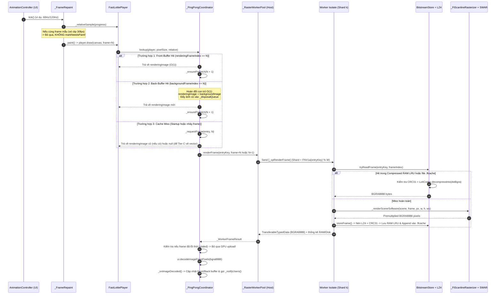

# Kiến trúc và Lựa chọn Thiết kế Chi tiết (`fastlottie`)

`fastlottie` là engine kết xuất Lottie/TGS thuần Dart (không dùng C++ FFI), kết hợp kiến trúc **Hybrid Dual-Engine**:
1. **Background Software Rasterizer Pipeline (Telegram-style)**: Quét dòng phân tích kiểu FreeType (`ftgrays` 24.8 fixed-point RLE) + pha trộn màu 64-bit SWAR BGRA8888 + nén LZ4 lưu vào RAM LRU và file đĩa append-only `.flcache` (`FLC1`) trên các Worker Isolate. Trên UI Isolate chỉ giữ cặp texture GPU double-buffer (`renderingImage` / `backgroundImage`) để hoán đổi con trỏ $O(1)$.
2. **Direct Flutter Canvas & Picture/Prewarmed Engine**: Vẽ vector trực tiếp lên `ui.Canvas`, lưu display list `ui.Picture` có giới hạn LRU, hoặc dựng trước toàn bộ chuỗi `List<ui.Image>` qua `prepareRaster`.

---

## 1. Sơ đồ Kiến trúc Tổng thể

```mermaid
flowchart TB
    subgraph Ingest["1. Tải & Giải mã (Ingest & Decode)"]
        SRC[".json / .tgs (GZip) / Network URI"]
        NET["network_io.dart\nHttpClient + FastLottieCancelToken\nCache đĩa nguyên bản (.tgsbin, 128-bit hash)\nAtomic rename (.tmp.$pid.$seq)"]
        DEC["decoding.dart: decodeLottieBytes()\nPhát hiện GZip magic (0x1f 0x8b)\nGiới hạn 16 MiB chống Zip-bomb"]
        SRC --> NET --> DEC
    end

    subgraph Compile["2. Biên dịch & Chuẩn hóa (Off-UI Isolate via compute)"]
        COMP["compiler.dart: _Compiler\nFail-fast whitelist schema check\nBiên dịch tĩnh Expression & Layer Control\nXây dựng DAG (_Layer, _Group, _Style, _Trim)"]
        TRACK["track.dart: _Keyframes & _Track\nĐóng gói Columnar TypedData (times, metadata, values, easing)\nPad stride bội số 4 cho Float32x4 SIMD (mặc định bật)\nBảng LUT sRGB <-> Linear & _SpatialCurve (129 mẫu)"]
        HASH["rle_rasterizer.dart: _ContentKeyHasher\nBăm 128-bit định danh toàn bộ cây scene\n(contentKey độc lập Isolate/phiên chạy)"]
        FORK["fork.dart: _Fork(warm: true)\nNhân bản trạng thái mutable (_cursor, output buffer)\nChia sẻ 100% _Keyframes bất biến, 0 đối tượng dart:ui"]
        DEC -->|"json.fuse(utf8)"| COMP
        COMP --> TRACK
        COMP --> HASH
        COMP --> FORK
    end

    subgraph Runtime["3. Điều phối trên UI Isolate (Player & Widget Layer)"]
        WIDGET["widget.dart: FastLottie / FastLottieNetwork / FastLottieView\nRepaintBoundary + _FastPainter + _FrameRepaint\nChỉ thông báo vẽ lại khi mẫu frame thực sự đổi"]
        PLAYER["fastlottie.dart: FastLottiePlayer.draw()\nTính toán BoxFit + DPR + Frame Quantization"]
        FORK -->|"Isolate.exit (Zero-copy)"| WIDGET
        WIDGET --> PLAYER
    end

    subgraph Paths["4. Ba Đường ống Kết xuất (3 Rendering Tiers)"]
        direction TB
        TIER1["Tier A: Prewarmed GPU Frames\n(prepareRaster)\nList<ui.Image> giữ toàn bộ frame trên GPU\nNgân sách mặc định 32 MiB"]
        TIER2["Tier B (Mặc định): Shared Ping-Pong Pipeline\n(raster_cache.dart + ping_pong.dart)\nDouble-buffered ui.Image (renderingImage / backgroundImage)\nNgân sách VRAM 32 MiB + Hàng đợi giải phóng theo lô"]
        TIER3["Tier C (Fallback / Vector): Direct Canvas + LRU ui.Picture\n(scene.dart + path_ops.dart + gradient.dart)\nVẽ trực tiếp hoặc lưu tối đa 120 ui.Picture / 100k lệnh"]
        
        PLAYER -->|"1. Nếu đã gọi prepareRaster"| TIER1
        PLAYER -->|"2. Mặc định (usePipeline: true)"| TIER2
        PLAYER -->|"3. Khi cache miss lạnh / useFrameRate: false / vượt ngân sách"| TIER3
    end

    subgraph WorkerPool["5. Sharded Background Worker Pool (worker_pool.dart)"]
        SHARD["Sharding theo FNV-1a(entryKey) % workerCount\n(2..4 persistent Isolates, giao tiếp bằng TransferableTypedData)"]
        BITSTREAM["bitstream_cache.dart: BitstreamStore\nL1: Compressed RAM LRU (chia theo worker)\nL2: File đĩa append-only .flcache (Header FLC1 + Index + CRC31)"]
        LZ4["lz4.dart: Lz4Codec & Lz4Scratch\nNén/Giải nén LZ4 thuần Dart, 0 cấp phát bộ nhớ\nFast-path cho pixel 32-bit lặp lại (offset == 4)"]
        SWRAST["rle_rasterizer.dart: _renderSceneSoftware()\nLàm phẳng Bézier thích ứng -> _PolyPath (SoA)\n_expandStroke & _applyDash -> _FtScanlineRasterizer (24.8 fixed-point)\n_RleSpans -> _SwarBlender (64-bit SWAR Premultiplied BGRA8888)"]
        
        TIER2 <-->|"Yêu cầu frame / Nhận BGRA8888\nui.decodeImageFromPixels"| SHARD
        SHARD --> BITSTREAM
        BITSTREAM <-->|"Cache Hit/Store"| LZ4
        BITSTREAM -->|"Cache Miss"| SWRAST
        SWRAST -->|"Ghi kết quả BGRA"| BITSTREAM
    end
```

---

## 2. Vòng đời Hoạt động của Ping-Pong Pipeline

---

## 3. Phân tích Lựa chọn Kiến trúc Chi tiết

### 3.1. Kiến trúc Single-Library (`part` / `part of`) & Trừu tượng hóa Nền tảng
- **Tổ chức `part` trong `lib/fastlottie.dart`**: Toàn bộ 11 module cốt lõi (`compiler.dart`, `track.dart`, `scene.dart`, `widget.dart`, `fork.dart`, `gradient.dart`, `path_ops.dart`, `raster_cache.dart`, `rle_rasterizer.dart`, `worker_pool.dart`, `ping_pong.dart`) thuộc cùng một library. Cách tổ chức này cho phép các lớp nội bộ truy cập trực tiếp trường private (`_cursor`, `_matrix`, `_values`, `_rasterEntry`) mà không cần mở public API hoặc tạo wrapper trung gian, giúp trình biên dịch AOT của Dart inline tối đa các hàm trên hot-path.
- **Conditional Imports cho Đa nền tảng (Native IO vs Web)**:
  - `isolate_io.dart` / `isolate_stub.dart`: Trên Native sử dụng `Isolate.spawn` và `TransferableTypedData` (chuyển vùng nhớ BGRA8888 zero-copy từ worker về UI); trên Web fallback về `StreamController` nội cục.
  - `platform_io.dart` / `platform_stub.dart`: Cung cấp `RandomAccessFile` đồng bộ (`PlatformFileHandle`) cho worker isolate đọc/ghi trực tiếp theo offset trong file `.flcache`.
  - `network_io.dart` / `network_stub.dart`: Quản lý tải HTTP/HTTPS với khả năng hủy tức thì qua `FastLottieCancelToken` (`request.abort()`, `socket.destroy()`) khi widget bị hủy hoặc cuộn khỏi màn hình, kèm bộ nhớ đệm file nguyên bản `.tgsbin` ghi nguyên tử qua file tạm `.tmp.$pid.$seq`.

### 3.2. Compiler "Fail-Fast", Biên dịch Tĩnh Expressions & Đồ thị Modifier DAG
- **Kiểm tra Whitelist nghiêm ngặt (`_Compiler.check`)**: Thay vì âm thầm bỏ qua các thuộc tính không hỗ trợ gây sai lệch hình ảnh, `_Compiler` đối chiếu từng trường JSON với tập whitelist `_allowedFields` và kiểm tra các cờ (`ddd`, `ao`, `bm`, `hasMask` phải bằng `0`/`false`). Mọi tính năng ngoài phạm vi đều ném `UnsupportedLottieException` kèm đường dẫn JSON chính xác (`$.layers[i]...`).
- **Biên dịch tĩnh Expressions (`_resolveContentExpressions`)**: Các biểu thức After Effects tham chiếu chéo thuộc tính như `$bm_rt = content('...').transform.scale`, `transform.rotation`, `opacity` hoặc `transform.xPosition`/`yPosition` được giải quyết ngay trong pha compile bằng Regex, kiểm tra chu trình (`resolving` set) và **nối thẳng (rewire) dữ liệu keyframe của nguồn vào đích**. Không có bộ thông dịch JavaScript nào chạy ở mỗi frame.
- **Đồ thị phi chu trình (DAG) cho Trim Paths (`_Shape` & `_TrimPart`)**: Trong chuẩn Lottie, một modifier `tm` (`_Trim`) có thể tác động lên các shape đã được khai báo và bắt vào `_Style` ở phía trên hoặc nằm trong nhóm lồng nhau. Compiler bọc mọi hình học trong lớp vỏ đại diện `_Shape`. Khi gặp `tm`, compiler đóng băng danh sách nội dung gốc vào `trim.inputs`, rồi thay thế nội dung của từng `_Shape` bằng `_TrimPart(trim, n)`. Đồ thị sau biên dịch là một DAG thuần Dart, không chứa đối tượng `dart:ui` và không cần duyệt lại cây layer lúc vẽ.

### 3.3. Bố cục Dữ liệu Kiểu Cột (Columnar Layout) & Nội suy SIMD trong `_Track`
Xem thêm số đo chi tiết tại [data-layout.md](data-layout.md).
- **Loại bỏ đối tượng trung gian sau Compile**: `_Key` và `_Ease` chỉ là builder tạm thời trong `_Compiler`. Sau khi biên dịch, `_Keyframes` chỉ giữ các mảng `TypedData` phẳng:
  1. `Float64List times`: Cột thời gian tách rời. Tìm kiếm nhị phân chỉ đọc mảng này trong L1 cache mà không chạm vào dữ liệu tọa độ.
  2. **Con trỏ thời gian `_cursor` $O(1)$**: `_Track.at(frame)` lưu lại chỉ số đoạn keyframe của lần lấy mẫu trước. Khi phát tuần tự, phép kiểm tra `frame >= times[_cursor] && frame < times[_cursor + 1]` trúng ngay trong $O(1)$ mà không cần binary search.
  3. `Int32List metadata`: Đóng gói 3 cột có độ dài `count` nối tiếp nhau:
     - `[0 .. count)`: Cờ bit (`holdFlag = 1`, `endFlag = 2`, `tangentFlag = 4`, `linearFlag = 8`) và số lượng đường cong easing (`easeCount = flags >> 4`).
     - `[count .. 2*count)`: `endOffset` đã giải quyết sẵn (nếu keyframe không có `e` riêng, nó trỏ thẳng tới `start` của keyframe kế tiếp mà không nhân đôi dữ liệu).
     - `[2*count .. 3*count)`: `easeOffset` trỏ vào mảng `Float64List easing`.
  4. `Float32List values` & **Nội suy `Float32x4` SIMD**: Giá trị của mỗi keyframe được xếp liền nhau theo vector. Mặc định `FastLottieOptions(useSimd: true)` được **bật**: với các track có `width >= 32` floats (như hình thái học Bézier nhiều đỉnh) và dùng chung easing, `stride` được làm tròn lên bội số của 4 (`(width + 3) & ~3`) và nội suy 4 số thực mỗi nhịp qua `Float32x4List` kèm vòng lặp xử lý phần dư vô hướng (scalar tail).
- **Giải phương trình Bézier & Không gian màu**:
  - **Temporal Easing**: Giải $x(t) = \text{fraction}$ bằng **Bracketed Newton-Raphson** (tối đa 16 bước, tự động thu hẹp khoảng `[lo, hi]` và chia đôi khi đạo hàm ở hai đầu quá phẳng) trước khi tính $y(t)$.
  - **Spatial Tangents (`_SpatialCurve`)**: Tính trước bảng 129 mẫu độ dài cung bằng toán học thuần Dart, cho phép nội suy theo khoảng cách thực mà không cần gọi `ui.Path.computeMetrics()`.
  - **Nội suy màu Gamma-correct**: Sử dụng bảng tra tĩnh `_srgbToLinear` (256 phần tử) và `_linearToSrgb` (4.097 phần tử có nội suy tuyến tính phần lẻ) để nội suy màu trong không gian tuyến tính với chi phí $O(1)$ thay vì gọi `math.pow()` mỗi frame.

### 3.4. Mẫu Thiết kế Template-Fork (`_Fork`) & Định danh Nội dung (`contentKey`)
- **An toàn Isolate & Zero Re-parse**: `FastLottieComposition._template` là cây `_Compiler` bất biến, hoàn toàn không chứa đối tượng `dart:ui` (`Path`, `Paint`, `Shader`), nhờ đó `fromBytesAsync` / `loadAsset` / `loadNetwork` có thể giải nén GZip, parse JSON (`json.fuse(utf8)`) và biên dịch trên worker rồi trả thẳng đồ thị đối tượng về UI isolate qua `Isolate.exit` (không cần serialize lại sang JSON).
- **Khởi động trước trên Worker (`prepareForPlayback`)**: Ngay trên worker giải mã, `prepareForPlayback()` tính sẵn khóa băm `contentKey` và tạo trước một bản sao `_preparedScene = _Fork(warm: true).scene(_template)`, đồng thời đánh giá (prime) toàn bộ các cờ `late final bool isStatic`, `isPathStatic`, `isSpatialStatic`, `isTranslationOnly`, `isSpatialIdentity`.
- **Chia sẻ Bộ nhớ & Khởi tạo Lazy**:
  - Player đầu tiên cần vẽ vector nhận ngay `_preparedScene`. Các player tiếp theo gọi `_Fork().scene(_template)` để tạo các node trạng thái nhẹ (chỉ cấp phát `_cursor` và `Float32List output` riêng), nhưng **chia sẻ 100% `_Keyframes` và `constant`**.
  - Khi một player vẽ qua `FastLottieRasterCache` (chế độ mặc định), thuộc tính `_scene` của player là lazy — nếu frame đã có trong cache raster, player **thậm chí không cần fork cây scene trên UI isolate**.
- **Băm định danh nội dung 128-bit (`_ContentKeyHasher`)**: Duyệt toàn bộ cấu trúc `_Compiler` (kích thước, tốc độ khung hình, các layer, transform, track, hình học, style, gradient, dash, precomp) bằng 4 thanh ghi trạng thái 32-bit nhân xoay để sinh ra chuỗi hex 32 ký tự `contentKey` hoàn toàn tất định giữa mọi Isolate, phiên chạy ứng dụng và nền tảng (IO/Web).

### 3.5. Ba Đường ống Kết xuất (3 Rendering Tiers) trong `FastLottiePlayer.draw`
Khi `FastLottiePlayer.draw()` được gọi, nó lựa chọn đường ống theo thứ tự ưu tiên:

1. **Tier A — Prewarmed GPU Frames (`prepareRaster`)**:
   - Dựng trước toàn bộ các frame nguồn (hoặc 1 frame nếu `composition.isStatic`) thành mảng `List<ui.Image>` ở độ phân giải vật lý `ceil(width * DPR) × ceil(height * DPR)`.
   - Kiểm tra ngân sách bộ nhớ RGBA trước khi cấp phát (mặc định `32 MiB`, có thể cấu hình). Giữ riêng kích thước nội dung thực `_rasterSize` chưa làm tròn để không làm méo pixel cuối khi DPR lẻ.
   - Khi vẽ chỉ tốn một lệnh `canvas.drawImageRect` với `FilterQuality.none`.

2. **Tier B (Mặc định khi `usePipeline: true`) — Shared Ping-Pong Pipeline (`FastLottieRasterCache`)**:
   - Mặc định widget `FastLottie` tự động mượn một instance `FastLottieRasterCache.pingPong` dùng chung có đếm tham chiếu qua `_DefaultPingPongScope`.
   - **Double-Buffered `ui.Image`**: Mỗi `_RasterEntry` (định danh bởi `(contentKey, pixelSize, poster, rateKey)`) chỉ giữ tối đa **2 texture GPU** tại một thời điểm: `renderingImage` (front buffer đang vẽ) và `backgroundImage` (back buffer chứa frame kế tiếp `(index + 1) % total` đã được worker giải mã trước).
   - Khi sang frame kế tiếp, `_PingPongCoordinator.lookup` chỉ thực hiện hoán đổi con trỏ `renderingImage = backgroundImage` trong $O(1)$ và phát lệnh prefetch cho frame tiếp theo.
   - **Deduplication nhiều Player**: Nếu nhiều widget trên màn hình phát cùng một sticker ở cùng kích thước và tốc độ, tất cả đều gắn vào cùng một `_RasterEntry`, dùng chung cặp texture GPU và chỉ tốn 1 luồng giải mã.
   - **Quản lý Ngân sách VRAM $O(1)$ & Bảo vệ Poster (`reservedPosterBytes`)**: Tách biệt danh sách LRU của animation (`_unpinnedAnims`) và poster 1-frame (`_unpinnedPosters`). Trước khi thu hồi bộ nhớ, `_acquire` kiểm tra tính khả thi trong $O(1)$. Nếu toàn bộ ngân sách đang bị các player hiển thị ghim (pinned), nó từ chối ngay và ghi nhận `_rasterRejectedGeneration` để không quét lặp lại ở các frame sau cho tới khi có entry được nhả.
   - **Giải phóng `ui.Image` theo lô (`_disposalQueue`)**: Các texture cũ bị thay thế không gọi `dispose()` ngay trong nhịp vẽ mà được đẩy vào hàng đợi để xả theo lô (`disposalBatchSize = 8`) trong `addPostFrameCallback`, tránh gây khựng driver GPU khi cuộn nhanh.
   - **Chống tràn hàng đợi (Backpressure & Latest-Desire-Wins)**: Mỗi `_RasterEntry` chỉ có tối đa 1 tác vụ đang chạy (`inFlightFrameIndex`) và 1 vị trí chờ (`pendingFrameIndex`). Nếu người dùng tua hoặc cuộn nhanh, frame mới nhất sẽ ghi đè `pendingFrameIndex`. Khi worker trả kết quả về nhưng frame đó đã lỗi thời (và không phải là lookahead kế tiếp), coordinator **bỏ qua luôn bước `ui.decodeImageFromPixels`** để không tốn băng thông upload lên GPU.
   - Khi front buffer đã có ảnh hợp lệ đầu tiên, nếu frame mới chưa kịp về, player tiếp tục vẽ `renderingImage` hiện tại thay vì rơi về vẽ vector gây giật cục trên UI isolate.

3. **Tier C — Direct Vector Canvas & Bounded LRU `ui.Picture` (`FastLottieCache`)**:
   - Được sử dụng khi `usePipeline: false`, khi `useFrameRate: false` (vẽ subframe nội suy mượt), khi vượt ngân sách VRAM của `rasterCache`, hoặc ở frame đầu tiên khi cache lạnh chưa có `coldFallback`.
   - Nếu không dùng `rasterCache` và `useFrameRate: true`, player lưu tối đa `maximumFrames = 120` đối tượng `ui.Picture` (display list độc lập độ phân giải) trong giới hạn độ phức tạp `maximumCommands = 100000`.
   - Tối ưu hóa trực tiếp trên `Canvas`:
     - **Phân cấp `_Transform`**: Tách biệt `isSpatialIdentity` (bỏ qua hoàn toàn `canvas.save()`/`transform()`), `isTranslationOnly` (chỉ gọi `canvas.translate(dx, dy)`), và ma trận đầy đủ.
     - **Primitive Fast-Path**: Hình chữ nhật và hình chữ nhật bo góc đơn lẻ không có nét đứt gọi thẳng `canvas.drawRect` / `canvas.drawRRect` mà không tạo `ui.Path`.
     - **Tách cờ `isPathStatic` và `isStatic`**: Đường dẫn của nhóm/shape không bị dựng lại khi chỉ có màu sắc hoặc độ mờ thay đổi. Các phép đo `ui.PathMetric` trong `_Trim` và `_Dash` được lưu đệm và tái sử dụng khi hình học gốc đứng yên dù thông số cắt/nét đứt chuyển động.
     - **Cắt tỉa Matte bằng `worldBounds`**: Chỉ những layer có `matte` mới dùng hai lệnh `canvas.saveLayer` (`BlendMode.dstIn` / `dstOut`, kèm `ColorFilter.matrix` cho Luma matte). Trước khi gọi `saveLayer`, `_Compiler.draw` tính giao điểm khung bao thế giới (`worldBounds`) giữa target và matte: nếu không giao nhau (với `dstIn`) thì bỏ qua hoàn toàn; nếu giao nhau thì chỉ cấp phát `saveLayer` đúng bằng vùng bao hợp nhỏ nhất (mở rộng 1px cho khử răng cưa).

### 3.6. Trình Kết xuất Phần mềm Thuần Dart (`rle_rasterizer.dart`)
Vì các đối tượng `dart:ui` (`Canvas`, `Path`, `Picture`) không thể khởi tạo hay sử dụng trên Background Isolate thông thường của Dart, `fastlottie` cài đặt một trình kết xuất đồ họa vector 2D phần mềm hoàn chỉnh để chạy trên `_RasterWorkerPool`:
1. **Làm phẳng Bézier thích ứng theo tỷ lệ màn hình (`_PolyPath`)**:
   - Từ ma trận affine hiện hành, tính hệ số phóng đại thực tế `maxScale` để chọn sai số phẳng `localFlatness = (0.25 / maxScale).clamp(0.005, 1.5)`.
   - Chia đôi đệ quy De Casteljau (`addCubic`, độ sâu tối đa 10) vào cấu trúc **Struct-of-Arrays (`_PolyPath`)** (`Float64List vx, vy`, `Int32List contourStart, contourEnd`, `Uint8List contourClosed`).
   - Các đường dẫn tĩnh (`src.isPathStatic`) chỉ được làm phẳng một lần và lưu trong `ws.staticPaths` của từng worker.
2. **Mở rộng nét vẽ (`_expandStroke`) & Nét đứt (`_applyDash`)**:
   - Sử dụng bộ đệm tái sử dụng `_StrokeScratch` (SoA `x, y, tx, ty`) để mở rộng đa giác nét vẽ với đầy đủ `butt`/`round`/`square` cap và `miter`/`round`/`bevel` join.
   - Tại các góc gấp phía trong (inner crease), đường bao đi xuyên qua tâm đỉnh `(vx, vy)` để quy tắc lấp đầy `NonZero` không tạo vết khuyết.
3. **Bộ quét dòng kiểu FreeType (`_FtScanlineRasterizer` & `_RleSpans`)**:
   - Chuyển đổi tọa độ sang số nguyên điểm cố định **24.8 fixed-point** (256 subpixels/pixel).
   - Cắt các cạnh đa giác qua lưới ô pixel, tích lũy độ che phủ (`_cellCover`) và diện tích hình thang (`_cellArea`) vào danh sách liên kết tĩnh theo từng hàng (`_rowHead`, `_cellX`, `_cellNext`), chỉ dọn dẹp dải dòng thực sự bị chạm tới (`_dirtyMinY .. _dirtyMaxY`).
   - Pha quét (`sweep`) hỗ trợ cả quy tắc `NonZero` và `EvenOdd`, xuất ra danh sách đoạn ngang nén **Run-Length Encoding (`_RleSpans`)**, tự động gộp các pixel liền kề có cùng độ che phủ (`cov` từ `1..256`). Mỗi span được đóng gói vào đúng 2 từ 32-bit: `word0 = (y << 16) | x` và `word1 = (len << 8) | (cov - 1)`.
4. **Bộ pha trộn 64-bit SWAR (`_SwarBlender`)**:
   - Dùng kỹ thuật **SWAR (SIMD Within A Register)** để nhân alpha và trộn `SrcOver` đồng thời hai cặp kênh `R+B` (`0x00FF00FF`) và `A+G` (`0xFF00FF00`) trên số nguyên premultiplied BGRA8888.
   - Với các span đặc (`sa == 255`) dài $\ge 8$ pixels, gọi thẳng `dst.fillRange()` của VM.
   - Với **Linear & Radial Gradient**: Tạo bảng tra 1024 màu premultiplied BGRA8888 (`_evalGradientLut`, cache lại nếu gradient tĩnh). Trên mỗi span ngang của Linear Gradient, tọa độ chiếu $t$ chỉ cần cộng thêm một bước nhảy hằng số `t += dtx` cho từng pixel.
   - Với **Matte & Precomp**: Chỉ rasterize phần diện tích giao nhau thực tế (`mx0..mx1, my0..my1` cho `dstIn`) trên các bộ đệm tạm tái sử dụng theo độ sâu (`_acquireScratch`).

### 3.7. Lưu trữ Bitstream Hai Tầng (`BitstreamStore`), LZ4 & Sharded Worker Pool
- **Sharding không khóa theo `FNV-1a(entryKey) % workerCount` (`_RasterWorkerPool`)**:
  - Pool khởi tạo `2..4` Worker Isolates bền vững (tùy số nhân CPU). Mọi yêu cầu cho cùng một `entryKey` luôn được định tuyến về cùng một shard.
  - Nhờ đó, mỗi file `.flcache` trên đĩa thuộc quyền đọc/ghi độc quyền của duy nhất một Worker Isolate, **không cần khóa file (file lock)** liên luồng, trong khi Host vẫn quản lý tổng dung lượng đĩa `_diskLru` (mặc định `128 MiB`) và ưu tiên giữ lại các file đang có player hoạt động (`activeKeys`).
- **Bộ nén LZ4 thuần Dart không cấp phát bộ nhớ (`Lz4Codec` & `Lz4Scratch`)**:
  - Tái sử dụng bảng băm 16.384 phần tử (`_hashLog = 14`) và buffer đầu ra qua `Lz4Scratch`.
  - Hỗ trợ dừng sớm (`abortAtLength: expectedBytes`): nếu frame không thể nén nhỏ hơn kích thước gốc, bộ nén dừng ngay và lưu thẳng byte BGRA8888 thô (`isRaw = true`).
  - Trong `decompressInto`, có **fast-path cho `offset == 4`**: các vùng nền trong suốt (`0x00000000`) hoặc mảng màu phẳng lặp lại chu kỳ 4 byte (1 pixel BGRA) được lấp nhanh bằng `dst.fillRange` hoặc vòng lặp 4 byte.
- **Định dạng File `.flcache` (`FLC1`) Chịu lỗi & Tự phục hồi**:
  - Cấu trúc file `<entryKey>.flcache`:
    - **Header 32 bytes** (Little-Endian): `magic = 0x464C4331 ('FLC1')`, `version = 1`, `width`, `height`, `frameCount`, `flags` (`bit 0 = Completed`, `bit 1 = Poster`), `writtenCount`, `uncompressedFrameBytes`.
    - **Bảng chỉ mục Frame (`frameCount * 16` bytes)**: Mỗi slot gồm `uint64 offset`, `uint32 storedLen`, và `uint32 meta = (isRaw << 31) | crc31`.
    - **Payload Append-Only**: Các khối frame nén LZ4 (hoặc Raw) được ghi nối tiếp ngay khi từng frame được render (hỗ trợ ghi nhảy cóc không cần theo thứ tự).
  - **Cơ chế tự chữa lỗi (Self-healing)**: Mỗi frame được bảo vệ bằng mã kiểm tra **CRC31** (31 bit thấp của CRC32). Khi mở file hoặc đọc frame, nếu phát hiện slot trỏ vượt quá độ dài file (do ứng dụng bị đóng đột ngột lúc đang ghi) hoặc sai CRC31, `BitstreamStore` tự động xóa slot hỏng về `0`, cắt bỏ phần đuôi thừa (`handle.truncate(maxEnd)`), tăng `recoveredCorruptions` và cho phép vẽ lại riêng frame đó mà không làm hỏng toàn bộ file cache.

### 3.8. Tầng Widget & Bộ lọc Thông báo Vẽ lại (`_FrameRepaint`)
- `FastLottie` quản lý `FastLottiePlayer` và `AnimationController` nội bộ (hoặc nhận `controller` ngoài), bọc `CustomPaint` trong `RepaintBoundary`.
- `FastLottieView` dành cho trường hợp caller tự quản lý vòng đời `player` (ví dụ khi dùng `prepareRaster`).
- `FastLottieNetwork` (hoặc `FastLottie.network`) tự động tải, lưu cache nguồn, biên dịch trên background isolate và hủy socket ngay khi widget unmount hoặc đổi URI.
- **Giảm thiểu Repaint thừa (`_FrameRepaint`)**:
  - Nhịp tick của `AnimationController` không bao giờ gọi `setState()`.
  - `_FrameRepaint._tick()` tính chỉ số frame mẫu đã lượng tử hóa theo FPS của composition và `maximumFrameRate`. Nếu màn hình chạy ở 120Hz nhưng animation là 30 FPS, các nhịp tick rơi vào cùng một mẫu frame (`sample == _last`) sẽ bị chặn lại, không gọi `notifyListeners()` và không kích hoạt `CustomPainter.paint()`.
  - Khi composition tĩnh (`composition.isStatic`) hoặc hệ thống bật `MediaQuery.disableAnimations`, ticker tự động dừng hoàn toàn (`_controller.stop()`).

---

## 4. Bảng Ánh xạ Module Mã nguồn

| File mã nguồn | Vai trò kiến trúc cốt lõi |
| :--- | :--- |
| `lib/fastlottie.dart` | Public API: `FastLottieComposition`, `FastLottiePlayer`, `FastLottieCache`, `FastLottieOptions`, điều phối 3 tầng render trong `draw()`. |
| `lib/decoding.dart` | `decodeLottieBytes()`: Phát hiện chữ ký GZip (`0x1f 0x8b`) cho `.tgs` và giải nén an toàn với giới hạn `maximumBytes` (16 MiB). |
| `lib/src/compiler.dart` | `_Compiler`: Kiểm tra schema fail-fast, biên dịch tĩnh expressions & Layer Control, dựng cây layer, precomp, matte, trim. |
| `lib/src/track.dart` | `_Keyframes`, `_Track`, `_SpatialCurve`: Lưu trữ keyframe dạng cột, con trỏ $O(1)$, Newton-Raphson easing, SIMD `Float32x4`, LUT sRGB. |
| `lib/src/scene.dart` | `_Transform`, `_Layer`, `_Group`, `_BezierGeometry`, `_Primitive`, `_Style`: Cây scene vector, tối ưu hóa ma trận và tính khung bao `worldBounds`. |
| `lib/src/path_ops.dart` | `_Shape`, `_TrimPart`, `_Trim`, `_Dash`: Đồ thị alias DAG cho Trim Paths và Stroke Dash kèm bộ nhớ đệm `ui.PathMetric`. |
| `lib/src/gradient.dart` | `_GradientSpec`: Hợp nhất các mốc màu/alpha bằng insertion sort tại chỗ và tạo `ui.Shader` cho đường vẽ `Canvas`. |
| `lib/src/fork.dart` | `_Fork`: Nhân bản trạng thái mutable của scene cho mỗi player, dùng chung `_Keyframes` bất biến và làm nóng các cờ tĩnh. |
| `lib/src/rle_rasterizer.dart` | `_FtScanlineRasterizer`, `_SwarBlender`, `_renderSceneSoftware`, `_ContentKeyHasher`: Trình kết xuất phần mềm RLE + SWAR thuần Dart và băm nội dung 128-bit. |
| `lib/src/raster_cache.dart` | `FastLottieRasterCache`, `_RasterEntry`: Quản lý ngân sách VRAM, kiểm tra admission $O(1)$, bảo vệ poster và xả `ui.Image` theo lô. |
| `lib/src/ping_pong.dart` | `_PingPongCoordinator`: Điều phối cặp `renderingImage` / `backgroundImage`, lookahead prefetch và chống tràn hàng đợi. |
| `lib/src/worker_pool.dart` | `_RasterWorkerPool`, `_softwareWorkerEntry`: Pool các Isolate phân mảnh theo FNV-1a và quản lý LRU đĩa `.flcache` toàn cục. |
| `lib/src/bitstream_cache.dart` | `BitstreamStore`: Cache frame nén trong RAM (LRU) và định dạng file `.flcache` (`FLC1`) kèm kiểm tra/phục hồi lỗi CRC31. |
| `lib/src/lz4.dart` | `Lz4Codec`, `Lz4Scratch`: Bộ nén và giải nén LZ4 thuần Dart tối ưu cho buffer pixel BGRA8888 (fast-path `offset == 4`). |
| `lib/src/widget.dart` | `FastLottie`, `FastLottieView`, `FastLottieNetwork`, `_FrameRepaint`, `_DefaultPingPongScope` (singleton ref-counted). |
| `lib/src/isolate_io.dart` / `isolate_stub.dart` | Giao tiếp Worker Isolate qua `SendPort`/`ReceivePort` và `TransferableTypedData` (hoặc fallback trên Web). |
| `lib/src/platform_io.dart` / `platform_stub.dart` | Truy cập file ngẫu nhiên đồng bộ (`PlatformFileHandle`) và quản lý thư mục cho `.flcache`. |
| `lib/src/network_io.dart` / `network_stub.dart` / `network_types.dart` | Tải mạng HTTP/HTTPS có hỗ trợ hủy tức thì (`FastLottieCancelToken`) và cache đĩa nguyên bản `.tgsbin`. |
